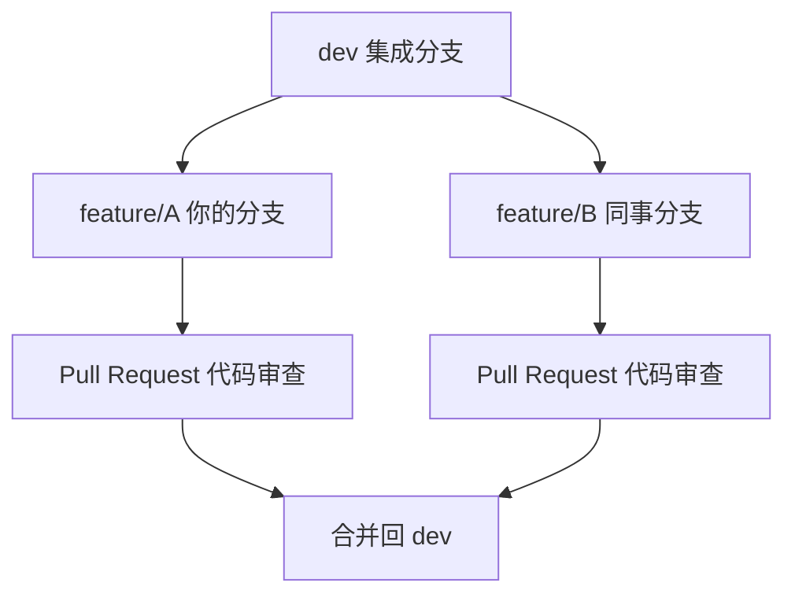
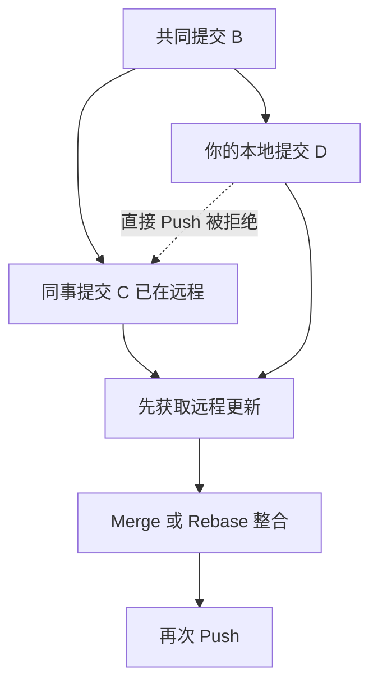
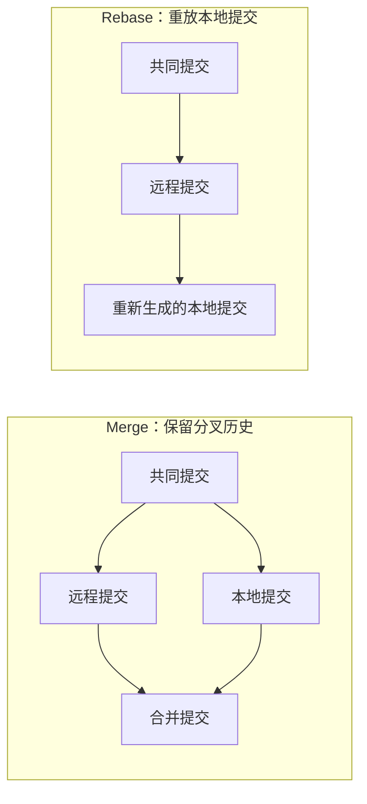
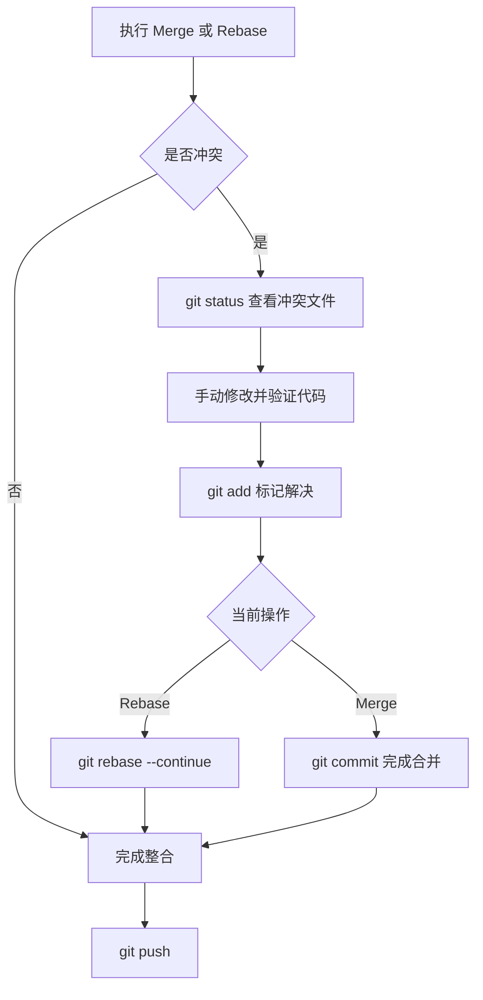

# Git 命令学习与图解

> Git Notebook · 简洁速查版

## 01 初始化与配置

| 命令 | 中文作用 |
|---|---|
| `git init` | 初始化本地 Git 仓库 |
| `git clone` | 克隆远程仓库 |
| `git config` | 查看或修改 Git 配置 |
| `git remote` | 管理远程仓库地址 |

## 02 查看状态与历史

| 命令 | 中文作用 |
|---|---|
| `git status` | 查看文件和仓库状态 |
| `git log` | 查看提交历史 |
| `git diff` | 查看文件改动差异 |
| `git show` | 查看某次提交的详情 |
| `git blame` | 查看文件每行的提交来源 |
| `git reflog` | 查看本地引用变动记录 |

## 03 暂存与提交

| 命令 | 中文作用 |
|---|---|
| `git add` | 将修改加入暂存区 |
| `git commit` | 将暂存内容提交到本地仓库 |
| `git restore` | 恢复工作区文件 |
| `git restore --staged` | 将文件移出暂存区 |
| `git reset` | 移动提交指针或重置暂存状态 |
| `git revert` | 新建反向提交以撤销指定提交 |
| `git stash` | 临时保存未提交的改动 |

## 04 分支管理

| 命令 | 中文作用 |
|---|---|
| `git branch` | 查看、创建或删除分支 |
| `git switch` | 切换分支 |
| `git switch -c` | 创建并切换到新分支 |
| `git merge` | 合并分支历史 |
| `git rebase` | 将提交重新应用到新的基点 |
| `git cherry-pick` | 将指定提交应用到当前分支 |
| `git tag` | 管理版本标签 |

## 05 远程协作

| 命令 | 中文作用 |
|---|---|
| `git fetch` | 获取远程更新但不自动合并 |
| `git pull` | 获取并整合远程更新 |
| `git pull --rebase` | 拉取后通过变基整合本地提交 |
| `git push` | 推送本地提交到远程仓库 |
| `git push -u` | 推送并设置上游跟踪分支 |
| `git remote -v` | 查看远程仓库地址 |

## 06 冲突与排查

| 命令 | 中文作用 |
|---|---|
| `git status` | 查看发生冲突的文件 |
| `git diff` | 检查冲突与改动 |
| `git add` | 标记冲突已解决 |
| `git merge --abort` | 放弃当前合并并尝试恢复 |
| `git rebase --continue` | 解决冲突后继续变基 |
| `git rebase --abort` | 取消当前变基 |
| `git bisect` | 二分查找引入问题的提交 |

---

# Git 核心图解

## 图 1：Git 四个区域

工作区修改文件，暂存区选择本次提交的内容，本地仓库保存提交历史，远程仓库用于团队共享。

## 图 2：多人分支协作

各自在功能分支开发，经过代码审查后再合并到共享分支。

## 图 3：为什么 Push 会被拒绝

同一分支的远程历史领先于本地时，Git 通常拒绝非快进推送，防止覆盖他人提交。

## 图 4：Merge 与 Rebase

Merge 保留原来的分叉结构；Rebase 会重新生成被重放的提交，因此不要随意变基已共享的提交。

## 图 5：冲突解决流程

> 注意：`git push --force` 可能覆盖共享分支历史，不要将其当作普通 Push 失败的解决办法。
