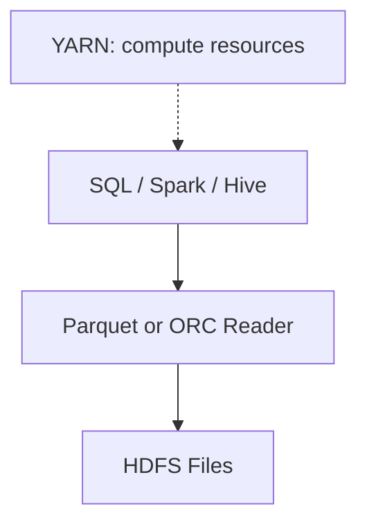
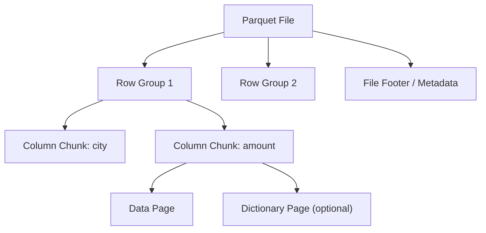
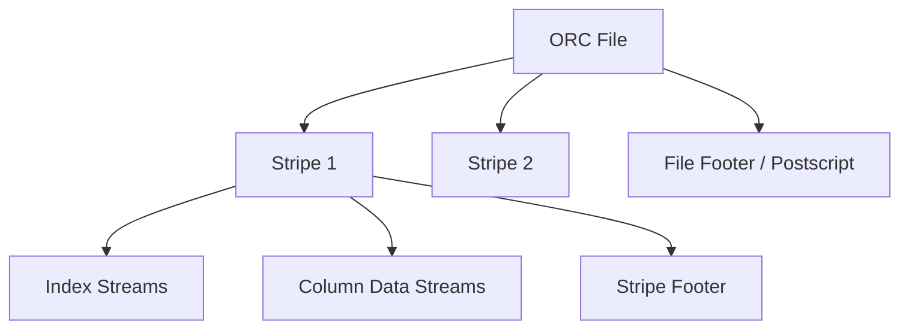
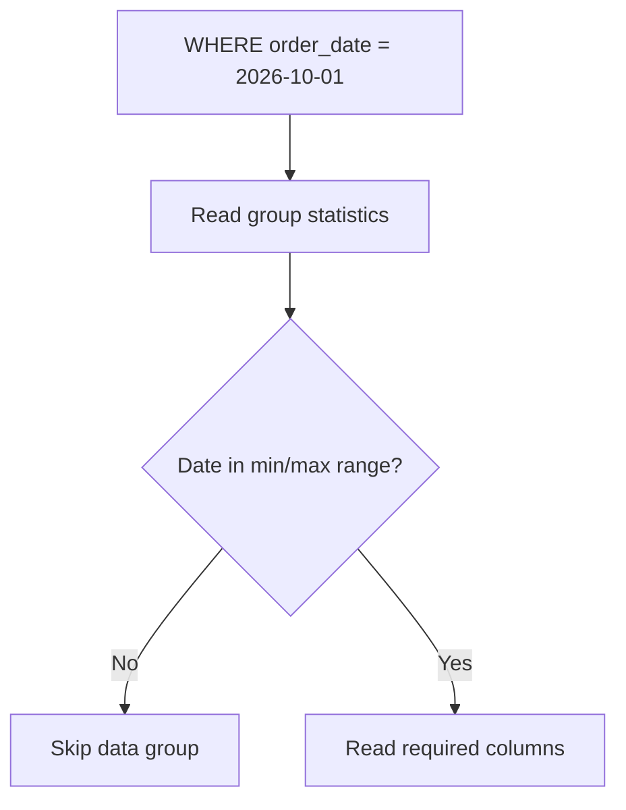
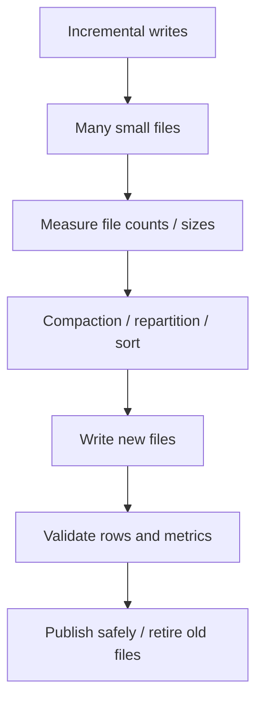
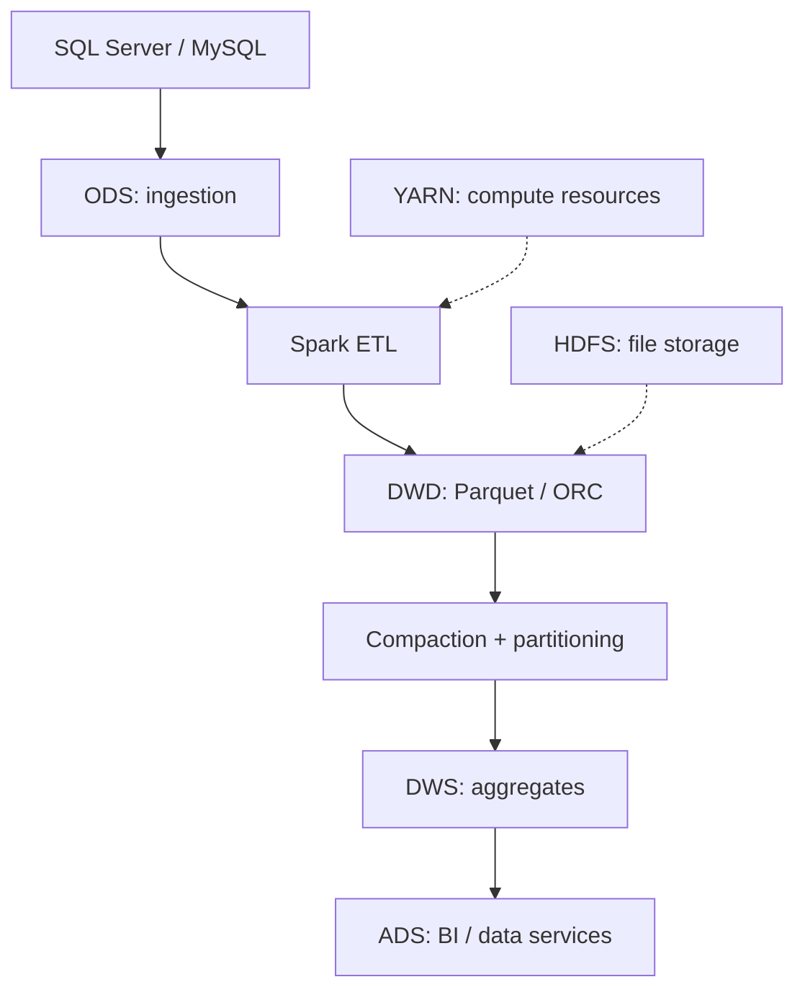

> **学习目标 / Learning Goals**：理解行存储与列存储、Parquet/ORC 的内部结构，以及分区裁剪、谓词下推、Compaction 和压缩如何影响数仓性能。

## 1. HDFS 与文件格式的区别 / HDFS vs. File Format

HDFS 管理文件的分布式存储；Parquet/ORC 定义文件内部的数据组织和编码方式；Spark/Hive 负责解析、查询和计算。HDFS stores distributed bytes; Parquet/ORC define the internal layout; Spark/Hive read and process the data.



## 2. 行存储 vs. 列存储 / Row vs. Columnar Storage

示例表 / Example table:

| order_id | user_id | city | amount | status |
|---|---|---|---:|---|
| 1001 | U01 | Beijing | 200 | paid |
| 1002 | U02 | Shanghai | 350 | paid |
| 1003 | U03 | Beijing | 180 | refund |

**行存储 / Row-oriented:** 一条记录的字段逻辑上相邻，适合按键定位整行和频繁事务修改。Stores fields of a record together; often suits point lookups and transactional updates.

```text
[1001, U01, Beijing, 200, paid]
[1002, U02, Shanghai, 350, paid]
[1003, U03, Beijing, 180, refund]
```

**列存储 / Columnar:** 同一列的数据集中组织，适合只读取少数列的大规模聚合。Groups values by column; often suits analytical scans and aggregations.

```text
city:   [Beijing, Shanghai, Beijing]
amount: [200, 350, 180]
status: [paid, paid, refund]
```

```sql
SELECT city, SUM(amount)
FROM dwd_order_detail
WHERE status = 'paid'
GROUP BY city;
```

这条查询只需要 `city`, `amount`, `status`，列式读取器可以跳过其他列。The query needs only three columns, enabling column pruning.

> 行存储也可能通过覆盖索引等方式优化读取；不能断言所有列式查询一定更快。Row stores can also optimize reads through indexes; performance depends on the engine and workload.

## 3. Parquet 的内部结构 / Parquet Layout



- **Row Group / 行组**：一批逻辑行。A logical group of rows.
- **Column Chunk / 列块**：一个 Row Group 中一列的数据。One column within a row group.
- **Page / 页**：列块中的编码、压缩单元。An encoding/compression unit within a column chunk.
- **Footer / 文件尾元数据**：描述 Schema、行组、列块位置等。Describes schema and locations of row groups and column chunks.

Parquet 并不是把整个文件的所有 `city` 值放在一起，而是**先按 Row Group 划分，再在行组内按列组织**。Parquet organizes columns within row groups, not necessarily one uninterrupted column for the whole file.

## 4. ORC 的内部结构 / ORC Layout



**Stripe** 是 ORC 的重要组织单位，包含列数据流、索引流及元数据。A stripe contains column data streams, index streams, and metadata.

| 维度 / Dimension | Parquet | ORC |
|---|---|---|
| 主要组织单位 / Main unit | Row Group | Stripe |
| 列裁剪 / Column pruning | 支持 / Yes | 支持 / Yes |
| 统计与数据跳过 / Statistics and skipping | 支持 / Yes | 支持 / Yes |
| 压缩 / Compression | 支持 / Yes | 支持 / Yes |
| 常见生态 / Typical use | Spark / Lakehouse / multi-engine | Hive / Hadoop analytics |

**没有绝对赢家。 / Neither format is universally faster.** 应按计算引擎、兼容性、数据特征和实测性能选择。Choose based on engine support, compatibility, data distribution, and benchmarks.

## 5. 五种关键优化 / Five Optimization Mechanisms

### 5.1 分区裁剪 / Partition Pruning

按 `order_date` 分区后，查询某天的数据可以跳过其他日期目录。Partition pruning skips unrelated date partitions.

```text
orders/
  order_date=2026-10-01/part-0001.parquet
  order_date=2026-10-02/part-0001.parquet
```

### 5.2 列裁剪 / Column Pruning

只读取查询需要的列，例如 `city`, `amount`, `status`。Reads only required columns.

### 5.3 谓词下推 / Predicate Pushdown

将过滤条件尽量交给文件读取层，减少读取后的无效数据处理。Pushes filters closer to the file reader.

### 5.4 数据跳过 / Data Skipping

利用 min/max 等统计信息判断数据组是否可能匹配。Uses statistics such as min/max to skip groups that cannot match.



### 5.5 压缩 / Compression

减少磁盘与网络 I/O，但会增加编解码 CPU 成本。Reduces I/O at the cost of codec CPU usage.

## 6. 小文件问题 / Small Files Problem

高频增量写入、输出分区过多或数据倾斜会产生大量小文件。Frequent incremental writes, excessive partitions, and skew may create many small files.

问题包括 NameNode 元数据压力、文件打开开销和大量小任务。Costs include metadata overhead, file-opening overhead, and excessive small tasks.

**HDFS Block、Parquet Row Group、ORC Stripe、Spark Partition、输出文件大小并不是同一个概念。** These are different concepts and should not be treated as interchangeable.

## 7. Compaction、重排与排序 / Compaction, Repartitioning and Sorting



- **Compaction / 紧凑化**：合并或重写碎片文件，减少文件数量。Rewrites fragmented files.
- **Repartition / 重分区**：调整 Spark 的数据分区，通常触发 Shuffle。Redistributes Spark partitions, typically via Shuffle.
- **Sorting / 排序**：让相近值聚集，有助于某些统计跳过和编码方式。Improves locality and sometimes compression.
- **Clustering / 聚集**：按照常用过滤字段组织数据。Organizes data around frequent query predicates.

### 7.1 PySpark 示例 / Example

```python
from pyspark.sql import SparkSession

spark = SparkSession.builder.appName("CompactOrders").getOrCreate()

df = spark.read.parquet("hdfs:///warehouse/dwd/orders/")

(df.coalesce(8)
   .write
   .mode("overwrite")
   .option("compression", "snappy")
   .parquet("hdfs:///warehouse/dwd/orders_compacted/"))
```

**生产安全 / Production safety**：不要直接读取并覆盖同一普通文件目录；应写入新位置、校验行数与指标、再安全发布。Do not overwrite the same plain file path being read; write to a separate location, validate, and publish safely.

| Spark API | 中文 | English |
|---|---|---|
| `coalesce(n)` | 常用于减少分区，默认避免全量 Shuffle | Often reduces partitions without full Shuffle |
| `repartition(n)` | 通常通过 Shuffle 重新分布数据 | Redistributes data through Shuffle |
| `repartition(n, col)` | 按列 Hash 分区，可能出现倾斜 | Hash-partitions by column and may skew |

## 8. 编码与压缩 / Encoding and Compression

| Codec | 典型特点 / Typical characteristics |
|---|---|
| Snappy | 高速读写 / Fast compression and decompression |
| ZSTD | 压缩率与速度可调 / Tunable ratio and speed |
| Gzip | 通常较高压缩率、CPU 成本较高 / Often good ratio with higher CPU cost |
| LZ4 | 强调速度 / Optimized for speed |

**字典编码 / Dictionary Encoding**：`Beijing, Beijing, Shanghai` → 字典 `0=Beijing, 1=Shanghai` → `0,0,1`。Replaces repeated values with dictionary IDs.

**RLE / 游程编码**：`A,A,A,B,B` → `A×3,B×2`。Stores repeated runs as value/count pairs.

编码与压缩不是同一个层次：列式格式可先编码，再使用 Snappy/ZSTD 等 Codec。Encoding and compression operate at different layers.

## 9. 数仓实际应用 / Data Warehouse Example



```sql
SELECT city, SUM(amount) AS total_amount
FROM dwd_order_detail
WHERE order_date = '2026-10-01'
  AND status = 'paid'
GROUP BY city;
```

可协同利用日期分区裁剪、列裁剪、谓词下推、数据跳过、压缩和 Compaction。This query may benefit from partition pruning, column pruning, pushdown, skipping, compression, and compaction when supported by the engine and file metadata.

**文件大小 / File size**：128–512 MB 可以作为批处理列式文件的初步测试区间，但不是硬性标准；应根据实际负载和数据量测试。128–512 MB can be an initial benchmark range, not a universal requirement.

**格式层次 / Format layers**：Parquet/ORC 是数据文件格式；Iceberg/Delta Lake/Hudi 提供更高层的表管理、元数据和事务能力。Parquet/ORC are file formats; Iceberg/Delta/Hudi add table-management capabilities.

## 10. Interview Q&A / 面试问答

<details><summary>**Q1. Why use Parquet instead of CSV for analytical workloads? / 为什么数仓常用 Parquet？**</summary>

**答：** Parquet 支持类型信息、列裁剪、压缩和统计信息，适合大规模聚合。

**Answer:** Parquet provides typed columnar data, pruning, compression, and statistics for analytical scans.

</details>

<details><summary>**Q2. How do row and column storage differ? / 行存储与列存储区别？**</summary>

**答：** 行存储把同一记录字段放在一起；列存储把同一列的值集中组织。

**Answer:** Row storage groups fields by record; column storage groups values by column.

</details>

<details><summary>**Q3. What is the difference between Parquet and ORC? / Parquet 与 ORC 区别？**</summary>

**答：** Parquet 以 Row Group/Column Chunk/Page 组织，ORC 以 Stripe/Streams 组织；两者都支持列式优化。

**Answer:** Parquet uses row groups, column chunks, and pages; ORC uses stripes and streams. Both support columnar optimizations.

</details>

<details><summary>**Q4. What is the small files problem? / 小文件为什么影响性能？**</summary>

**答：** 大量小文件增加元数据、文件打开和任务调度开销。

**Answer:** Too many small files increase metadata, file-opening, and scheduling overhead.

</details>

<details><summary>**Q5. How do you safely compact Parquet files? / 如何安全合并文件？**</summary>

**答：** 写到新位置、校验数据、采用安全发布或事务机制切换，再按策略清理旧文件。

**Answer:** Write to a new location, validate results, publish safely or transactionally, then retire old files.

</details>

<details><summary>**Q6. What is the difference between coalesce and repartition? / 两者区别？**</summary>

**答：** coalesce 通常减少分区并避免全量 Shuffle；repartition 通常通过 Shuffle 重新分布。

**Answer:** Coalesce often reduces partitions without a full shuffle; repartition typically reshuffles data.

</details>

<details><summary>**Q7. Does compression always make queries faster? / 压缩一定更快吗？**</summary>

**答：** 不一定；压缩降低 I/O，但增加 CPU 开销，需要实测。

**Answer:** No. Compression saves I/O but consumes CPU, so benchmark the workload.

</details>

<details><summary>**Q8. Is Parquet the same as Iceberg? / Parquet 等于 Iceberg 吗？**</summary>

**答：** 不是。Parquet 是文件格式，Iceberg 是管理文件和快照等信息的表格式。

**Answer:** No. Parquet is a data file format; Iceberg is a table format managing files, metadata, and snapshots.

</details>

## 11. 总结 / Summary

**中文**：列式存储适合分析查询；Parquet/ORC 利用列组织、编码和统计信息优化读取；Compaction、分区裁剪、排序和压缩需要结合实际数据与查询负载选择。

**English:** Columnar formats support analytical workloads through column-oriented reads, encoding, and statistics. Compaction, pruning, sorting, and compression should be tuned for real data and query patterns.

## References / 参考资料

- [Apache Parquet Format](https://github.com/apache/parquet-format)
- [Apache ORC](https://orc.apache.org/)
- [Apache Spark Documentation](https://spark.apache.org/docs/latest/)
