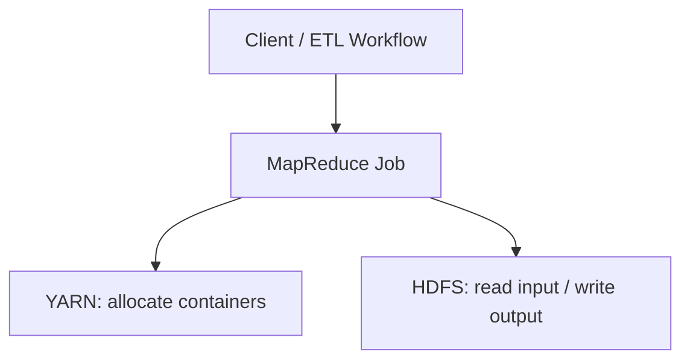
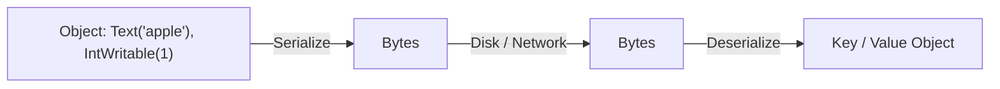
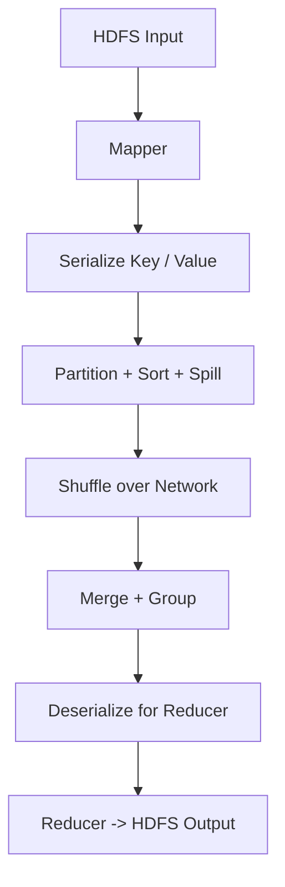
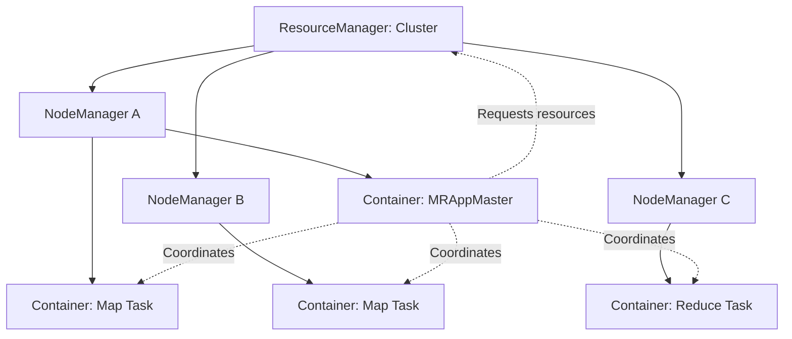
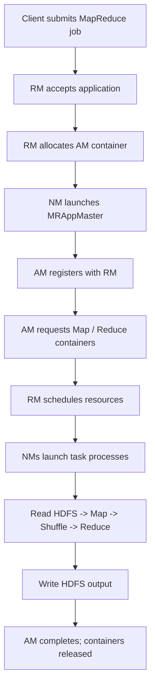
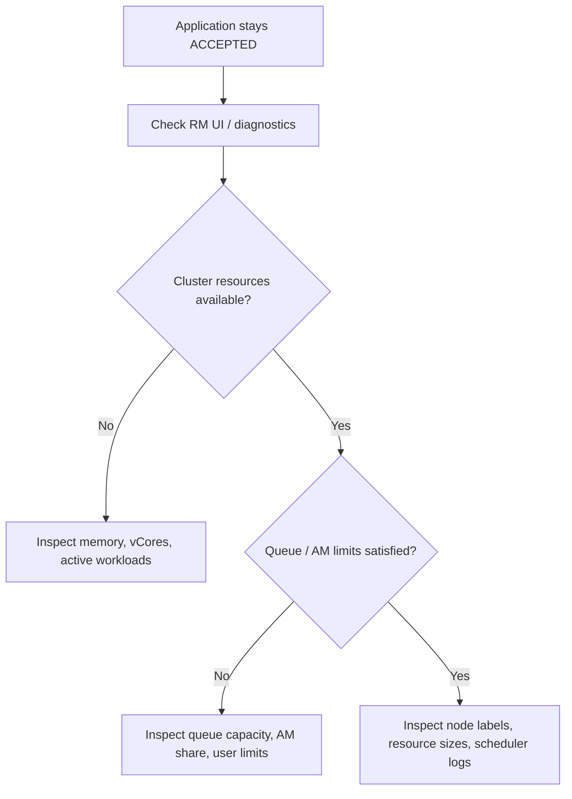

> **学习目标 / Learning Goals**：理解对象为什么需要序列化、`Writable` 与 `WritableComparable` 的区别、Shuffle 中序列化的作用，以及 YARN 的资源分配、任务启动和生产排障。

## 1. Hadoop 组件如何协作？ / How Hadoop Components Work Together

| 组件 / Component | 中文职责 | English responsibility |
|---|---|---|
| HDFS | 存储分布式文件 | Stores distributed files |
| MapReduce | 执行分布式批处理计算 | Executes distributed batch computations |
| YARN | 管理计算资源、调度应用 | Allocates cluster resources and schedules applications |
| Workflow Scheduler | 编排 ETL 时间与依赖关系 | Orchestrates ETL schedules and dependencies |



> **注意 / Note**：YARN 资源调度与 Airflow、DolphinScheduler 的工作流调度不是同一件事。YARN manages computing resources; workflow schedulers manage task dependencies and timing.

## 2. 序列化与反序列化 / Serialization and Deserialization

**序列化 / Serialization**：把内存中的对象编码成字节，以便存储或跨进程、跨节点传输。Converts an in-memory object into a defined byte representation.

**反序列化 / Deserialization**：按相同格式将字节恢复为可使用的数据对象。Reconstructs an object from its encoded bytes.



### 2.1 为什么 MapReduce 需要序列化？ / Why Does MapReduce Need It?

Mapper 输出的 Key/Value 可能进入内存缓冲区、溢写到本地磁盘、参与排序、经过 Shuffle 网络传输，并被 Reducer 读取。序列化使数据具有明确的二进制表示。Mapper outputs are buffered, spilled, sorted, transferred during Shuffle, and consumed by reducers; a defined binary format enables these operations.



> **细节 / Detail**：Shuffle 并不是每次比较 Key 都先构造 Java 对象；Hadoop 可以使用基于序列化字节的比较器。Shuffle can compare serialized keys without fully deserializing every comparison.

### 2.2 Writable 和 WritableComparable

| 接口 / Interface | 作用 / Purpose | 典型用途 / Typical use |
|---|---|---|
| `Writable` | `write()` 序列化；`readFields()` 反序列化 / read and write bytes | 自定义 Value / Custom values |
| `WritableComparable<T>` | 同时支持 Writable 与比较 / Writable plus ordering | 自定义 MapReduce Key / Custom keys |

常见类型 / Common types：`IntWritable`, `LongWritable`, `Text`, `DoubleWritable`, `BooleanWritable`。

**必须保持字段读写顺序一致。 / The read order must match the write order.**

```java
import java.io.DataInput;
import java.io.DataOutput;
import java.io.IOException;
import org.apache.hadoop.io.Writable;

public class StudentWritable implements Writable {
    private int age;
    private String name;

    public StudentWritable() {} // Required for deserialization

    public StudentWritable(int age, String name) {
        this.age = age;
        this.name = name;
    }

    @Override
    public void write(DataOutput out) throws IOException {
        out.writeInt(age);
        out.writeUTF(name);
    }

    @Override
    public void readFields(DataInput in) throws IOException {
        age = in.readInt();
        name = in.readUTF();
    }
}
```

若先写 `age` 再写 `name`，读取时也必须先读 `age` 再读 `name`。If fields are written as `age` then `name`, they must be read in the same order.

**不要混淆 / Avoid confusion**：HDFS 存储字节，并不要求每个 CSV、JSON、Parquet 或 ORC 文件都使用 `Writable` 格式。HDFS stores bytes; Writable is not a mandatory format for every HDFS file.

## 3. YARN 为什么出现？ / Why YARN?

Hadoop 1.x 的 JobTracker 同时承担资源管理与 MapReduce 作业协调职责。YARN 将**集群级资源管理**与**应用级执行协调**拆分，以支持多个计算框架共享集群资源。YARN separates cluster-wide resource allocation from per-application coordination.

## 4. YARN 四个核心概念 / Four Core Concepts

| 组件 | 中文解释 | English explanation |
|---|---|---|
| ResourceManager (RM) | 全局资源分配与应用接收 | Cluster-wide resource allocation and application admission |
| NodeManager (NM) | 单节点 Container 启动、监控和清理 | Launches and monitors containers on a node |
| ApplicationMaster (AM) | 为一个应用申请资源并协调执行 | Negotiates resources and coordinates one application |
| Container | 资源额度与进程执行环境，不等同于 Docker | Allocated resources and an execution environment, not necessarily Docker |

**MRAppMaster** 是 MapReduce 对 ApplicationMaster 的具体实现；它不是另一个独立的管理层。**MRAppMaster is the MapReduce-specific implementation of the AM role.**



### 4.1 为什么先分配 AM Container 再启动 AM？ / Why Allocate Before Launch?

AM 本身是消耗 CPU、内存的进程。RM 先为 AM 分配首个 Container，目标节点上的 NM 才能在其中启动 AM。The AM consumes resources itself, so YARN must allocate its container before the NM launches the AM process.

**一个 NM 可以管理多个 Container，也可以承载多个 AM。** AM 通常按运行中的应用划分，而不是每台 NM 固定一个。One NM can manage multiple containers and host AMs for different applications, subject to available resources and scheduler limits.

### 4.2 MapReduce on YARN 完整流程 / Job Lifecycle



实际执行中 Map、Reduce 资源申请及 Shuffle 可以部分重叠，图中是概念顺序。In practice, Map/Reduce allocation and Shuffle can overlap.

## 5. 调度与数据本地性 / Scheduling and Data Locality

- **Capacity Scheduler**：通过队列管理容量保障、上限、用户限制和应用并发。Controls queue capacities, limits, and concurrency.
- **FIFO / Fair scheduling concepts**：理解先进先出与公平共享的思想；实际支持和默认调度器依赖版本。Scheduler availability and defaults depend on the Hadoop version.
- **Data locality**：尽可能在数据所在节点或机架附近运行任务，减少远程读取；不是绝对保证。Prefer compute near data, when feasible.
- **AM 与 Task 都需要资源**：不能把全部资源只分给 Task。Both AMs and tasks consume resources.

## 6. 生产问题与排查 / Production Troubleshooting

### 6.1 应用长期 ACCEPTED / Application Stuck in ACCEPTED



可能原因：集群资源不足、队列容量或 AM 配额限制、节点资源规格不匹配、节点标签或健康状态问题。Possible causes include resource shortages, queue limits, AM limits, or node constraints.

### 6.2 Container 被终止 / Container Killed

区分 JVM `OutOfMemoryError: Java heap space` 与 YARN Container 超出物理/虚拟内存限制。它们不是同一个错误。Distinguish Java heap OOM from YARN container memory-limit violations.

还要检查：节点故障、任务代码异常、依赖缺失、HDFS 路径权限、应用被终止。Also check node failures, code errors, dependencies, file permissions, and explicit termination.

### 6.3 调优方向 / Tuning Priorities

1. 评估 NM 可分配内存、vCores，并为 OS、DataNode 等进程留出空间。Reserve resources for the OS and daemons.
2. 合理设置 AM / Task Container 规格，避免单个申请过大而无法调度。Right-size containers.
3. 设置队列容量、最大容量、AM 资源限制和并发策略。Configure queue policies.
4. 结合 Spark/MapReduce 执行日志排查数据倾斜、Shuffle、过多小任务。Inspect application-level bottlenecks; adding resources is not always the fix.

## 7. 常用命令 / Useful Commands

```bash
jps
start-yarn.sh

yarn node -list
yarn application -list
yarn application -status application_XXXXXXXXXXXXX_0001
yarn logs -applicationId application_XXXXXXXXXXXXX_0001
yarn queue -status default
```

ResourceManager UI 常见端口：`8088`，实际以配置为准。The RM web UI commonly uses port 8088, subject to configuration.

## 8. Interview Q&A / 面试问答

<details><summary>**Q1. What is the difference between ResourceManager and ApplicationMaster? / RM 与 AM 的区别？**</summary>

**答：** RM 负责集群级资源分配；AM 负责单个应用的资源申请与执行协调。

**Answer:** RM manages cluster-wide allocation; AM negotiates resources and coordinates a single application.

</details>

<details><summary>**Q2. Is MRAppMaster different from ApplicationMaster? / MRAppMaster 和 AM 是两个独立进程吗？**</summary>

**答：** MRAppMaster 是 MapReduce 的 AM 实现，不是通用 AM 之外的第二层管理进程。

**Answer:** MRAppMaster is the MapReduce-specific AM implementation, not an extra management process.

</details>

<details><summary>**Q3. Why allocate a Container before launching AM? / 为什么先分配 Container？**</summary>

**答：** AM 也是需要 CPU、内存的进程，必须先获得运行资源。

**Answer:** The AM is a process requiring CPU and memory; it needs allocated resources before launch.

</details>

<details><summary>**Q4. Can three NodeManagers host ten AMs? / 3 个 NM 能运行 10 个 AM 吗？**</summary>

**答：** 可以，只要节点资源和调度限制允许；一个 NM 能管理多个 Container。

**Answer:** Yes, if resources and scheduler limits permit; each NM can manage multiple containers.

</details>

<details><summary>**Q5. Why does a YARN application remain ACCEPTED? / 为什么一直 ACCEPTED？**</summary>

**答：** 检查集群资源、队列容量、AM 配额、节点资源规格和调度诊断。

**Answer:** Check cluster capacity, queue limits, AM quotas, node resource requirements, and scheduler diagnostics.

</details>

<details><summary>**Q6. How is Writable related to Shuffle? / Writable 与 Shuffle 有什么关系？**</summary>

**答：** Mapper 的 Key/Value 需要编码成字节，以支持缓冲、排序、溢写与网络传输；Reducer 再按协议读取。

**Answer:** Writable defines a binary representation for buffering, sorting, spilling, and transferring map outputs before reducers consume them.

</details>

<details><summary>**Q7. Why use WritableComparable for a custom MapReduce key? / 自定义 Key 为什么用 WritableComparable？**</summary>

**答：** Key 既需要序列化，也需要参与 Shuffle 的排序和分组比较。

**Answer:** Keys need serialization and ordering for Shuffle sorting and grouping.

</details>

<details><summary>**Q8. How is YARN different from Airflow? / YARN 与 Airflow 有何区别？**</summary>

**答：** YARN 分配计算资源；Airflow 编排任务时间和依赖。

**Answer:** YARN allocates compute resources; Airflow orchestrates workflows and dependencies.

</details>

## 9. 总结 / Summary

**中文**：MapReduce 使用序列化格式处理跨节点 Key/Value 数据；YARN 负责集群资源管理。RM 管全局资源，NM 管节点，AM 管应用，Container 承载进程，Task 执行计算。

**English:** MapReduce serializes key/value data for distributed processing. YARN manages resources: RM allocates cluster capacity, NM manages nodes, AM coordinates applications, containers host processes, and tasks perform computation.

## References / 参考资料

- [Apache Hadoop Documentation](https://hadoop.apache.org/docs/current/)
- [Apache Hadoop YARN](https://hadoop.apache.org/docs/current/hadoop-yarn/hadoop-yarn-site/YARN.html)
- [Hadoop Writable API](https://hadoop.apache.org/docs/current/api/org/apache/hadoop/io/Writable.html)
