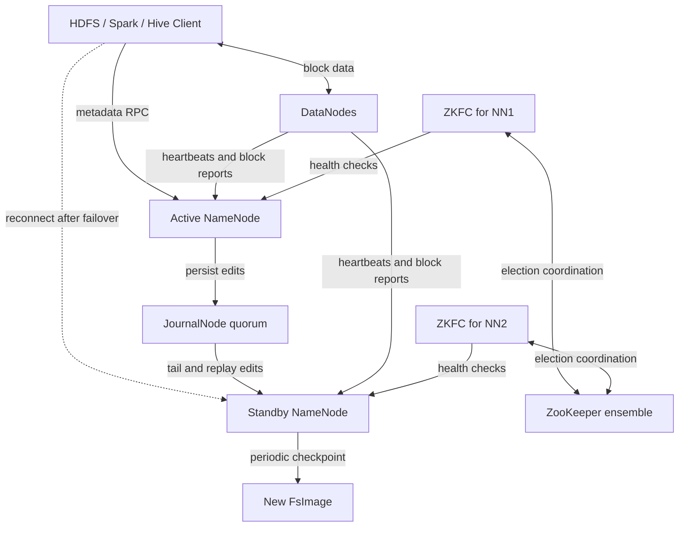
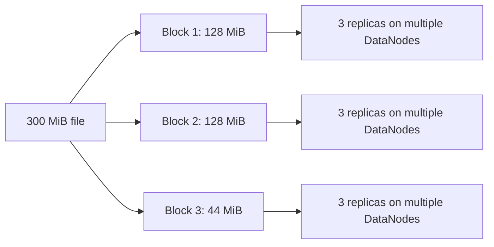
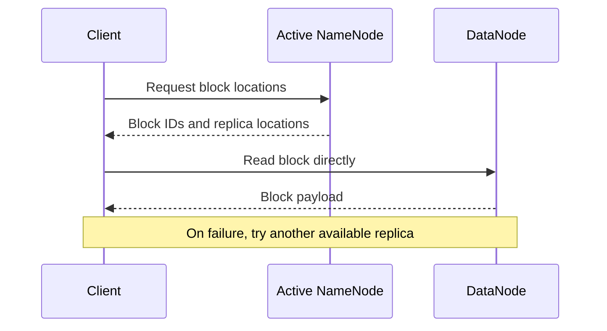
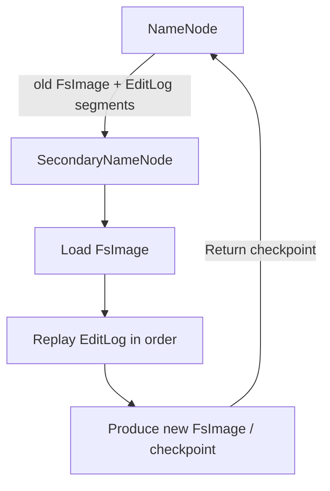
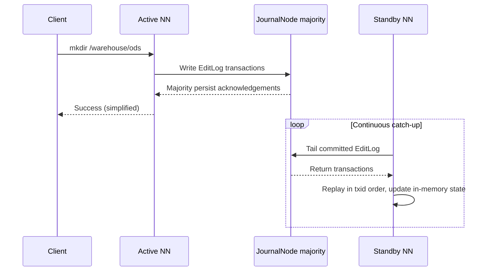
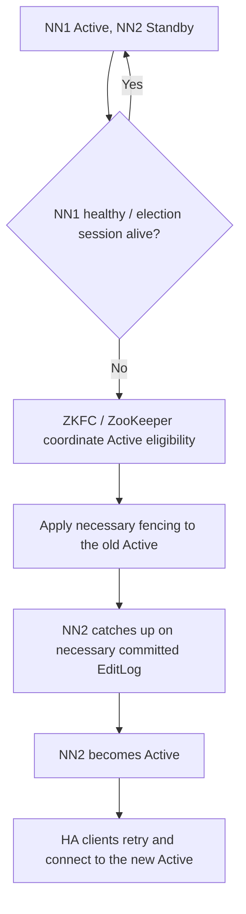
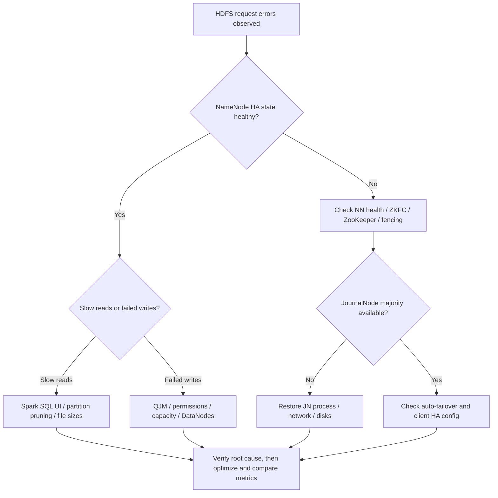
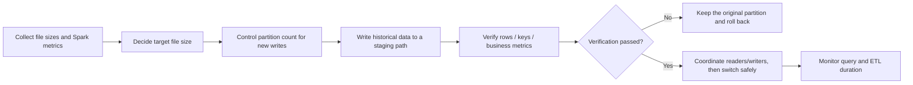

# HDFS Architecture & Reliability Engineering｜HDFS 架构与可靠性工程

> An operations-oriented companion covering **NameNode, DataNode, Block, FsImage, EditLog, Checkpoint, JournalNode, ZKFC, ZooKeeper, and Fencing**.
>
> Scope: typical **Hadoop 3.x HDFS HA with Quorum Journal Manager (QJM), two NameNodes, and automatic failover**. Behavior varies by distribution and configuration.

## 1. Overview

**Problem context.** HDFS availability rests on two independent chains — the metadata service (NameNode) and block storage (DataNode replicas). This topic focuses on the reliability mechanisms of the metadata chain: checkpointing, metadata synchronization, and HA failover.

### 1.1 The whole picture in one diagram



**Separate three responsibilities — do not conflate them:**

| Mechanism | What it solves | Main participants | Key action |
|---|---|---|---|
| Checkpoint | Shortens EditLog replay during metadata recovery | Non-HA: SecondaryNameNode; HA: Standby NameNode | Produce a new FsImage |
| Metadata sync | Lets the Standby catch up with the Active namespace | Active, JournalNodes, Standby | Write EditLog → majority ack → tail and replay |
| HA failover | Keeps metadata service alive when a NameNode fails | ZKFC, ZooKeeper, NameNodes, Fencing | Health checks, election, fencing, takeover |

## 2. HDFS Fundamentals（Architecture）

**Problem context.** Before troubleshooting, be explicit about *who stores what* — confusing NameNode and DataNode responsibilities is where most HDFS misdiagnoses start.

### 2.1 Component responsibilities

| Component | Core responsibility | Not responsible for |
|---|---|---|
| NameNode (NN) | Namespace, permissions, file-to-block mapping, block locations | Does not carry normal file data streams |
| DataNode (DN) | Stores actual blocks; serves client reads/writes; sends heartbeats and block reports to the NN | Does not manage the filesystem namespace |
| Client | Asks the NN for metadata; transfers file blocks directly with DNs | Does not proxy all data through the NN |
| Block | Logical unit of distributed file storage | Not a Spark task, not a Parquet row group |

### 2.2 Block math

For a 128 MiB block size and a 300 MiB file: Block 1 = 128 MiB, Block 2 = 128 MiB, Block 3 = 44 MiB, so **logical blocks = ceil(300 / 128) = 3**. At replication factor 3, **total block replicas = 3 × 3 = 9**.



> **Common pitfall:** a 1 MiB file does not occupy 128 MiB of data space. Block size is the maximum logical chunk; small files are not padded to fill a block. Replication, checksums and filesystem metadata add their own overhead.

### 2.3 HDFS read path



During reads the NameNode **provides metadata**; actual data flows from DataNodes. HA protects metadata-service availability; block replication protects data-block fault tolerance. They are different mechanisms.

### 2.4 Four "logs/states" that get confused

| Name | What it holds | What it is used for |
|---|---|---|
| FsImage | Namespace snapshot at a moment | Recovery baseline, checkpointing |
| EditLog | Metadata change transactions | Recovery increments, active-standby sync |
| Service logs | Errors, warnings, process behavior | Operations troubleshooting; never replayed into the namespace |
| DataNode block reports | Blocks a DN currently holds and their state | Help the NN maintain block location info |

## 3. Checkpoint: FsImage, EditLog, and Checkpointing

**Problem context.** On restart or recovery, a NameNode replays the EditLog on top of the FsImage to rebuild the namespace; the longer the log, the slower the recovery. Checkpointing folds confirmed transactions into a fresh snapshot precisely to shorten that replay.

### 3.1 Three concepts

| Concept | Meaning | Analogy |
|---|---|---|
| FsImage | Persistent namespace snapshot at a transaction boundary | A full save file |
| EditLog | Ordered transactions recorded after that boundary | An incremental change journal |
| Checkpoint | Materializes a newer FsImage by applying the relevant edits | Periodically producing a new save file |

Example: an old FsImage contains state up to `txid=1000`, the EditLog records `1001..5000`, and a completed checkpoint yields an FsImage containing state up to `txid=5000`.

### 3.2 Non-HA: what SecondaryNameNode does



Conceptual workflow:

1. The NameNode serves metadata operations and persists its EditLog.
2. SecondaryNameNode triggers a checkpoint by period or log size, coordinating edit-log rolls and fetching the needed files.
3. In its own memory it loads the old FsImage and applies the corresponding edits.
4. It produces a new FsImage and hands the checkpoint back to the NameNode.
5. Future recoveries start from the newer FsImage, reducing the log that must be replayed.

**Key constraint: SecondaryNameNode is not a standby NameNode** — it cannot automatically become Active if the NameNode fails, and a checkpoint is not a block-data backup.

### 3.3 HA: why there is usually no SecondaryNameNode

In a standard HDFS HA deployment, **the Standby NameNode performs checkpointing itself**: it has been continuously replaying the shared EditLog, maintains the namespace state, and can produce a new FsImage from it, providing checkpoints to the Active as the mechanism prescribes.

| Non-HA | HA |
|---|---|
| Single NameNode + SecondaryNameNode (common) | Active NN + Standby NN |
| SecondaryNameNode runs checkpoints | Standby NN runs checkpoints |
| SecondaryNameNode cannot take over automatically | Standby NN can take over via a safe transition |

**In one sentence:** SecondaryNameNode mainly builds checkpoints; a Standby NameNode combines log catch-up, checkpointing, and failover capability.

### 3.4 How to verify

- In an isolated test cluster, watch the `fsimage_` / `edits_` files in the NameNode storage directory roll forward with advancing txids, confirming checkpoints land as expected.
- Use `hdfs haadmin -getServiceState` (see 6.1) to confirm the Active/Standby states match checkpoint behavior.
- Note: **the Standby continuously tails and replays the EditLog but may lag briefly**; before takeover it must ensure the necessary committed edits have been applied.

## 4. QJM and JournalNodes: Shared EditLog

**Problem context.** An HA pair needs one shared edit log as the consistent basis for Standby catch-up and takeover. QJM replaces a shared-storage device with majority acknowledgement across JournalNodes.

### 4.1 Write and catch-up flow



**Key detail:** the Standby catches up continuously and automatically, but it is not synchronized to the exact same instant as the Active; brief lag is normal under healthy operation.

JournalNodes store **HDFS namespace EditLog transactions** — not application logs, not Spark logs, and not actual file blocks.

### 4.2 Quorum rules

For `N` JournalNodes, the minimum successful acknowledgements per write:

\[
Q = \left\lfloor \frac{N}{2} \right\rfloor + 1
\]

| JNs | Write majority | Tolerable JN failures |
|---:|---:|---:|
| 3 | 2 | 1 |
| 5 | 3 | 2 |
| 7 | 4 | 3 |

With 3 JNs and 1 down, the remaining 2 still form a majority; with 2 down, only 1 remains and new EditLog writes cannot satisfy QJM's normal commit condition.

**Key constraint:** the JN majority decides **whether EditLog writes succeed** — it is not a health-check formula for "is the Active dead". ZooKeeper also relies on its own quorum, but it is a separate coordination system.

### 4.3 How QJM helps stop a stale Active from writing

JournalNodes use an **epoch / writer-fencing** mechanism. After a new Active establishes a higher writer epoch, JournalNodes reject writes with the old epoch, preventing a stale Active from committing outdated transactions to the shared EditLog. This is one of the important protections against split-brain corrupting metadata.

### 4.4 Incident example: lost JournalNode majority

With 3 JNs and only 1 alive, new metadata writes generally cannot commit — but this **does not mean ZooKeeper necessarily elects a new Active immediately**, because switching NameNodes cannot conjure back a JournalNode majority.

Reads of existing files **may still succeed** if the NameNode can still serve metadata and DataNodes hold available blocks; the actual outcome depends on the failure's scope, NameNode state, and the operation in question. Do not equate "edit writes failing" with "all reads failing immediately".

### 4.5 How to verify

See the "one JN down / two JNs down" experiments in 8.1: in an isolated test cluster, stop 1/3 and then 2/3 of the JournalNodes and observe whether EditLog write behavior matches the table above.

## 5. Automatic Failover and Fencing

**Problem context.** When the Active NameNode fails, two questions must be answered: "who may take over" and "how is the old Active fenced off". Without coordination and fencing, two masters (split brain) can corrupt shared metadata.

### 5.1 Who does what

| Component | Responsibility |
|---|---|
| ZKFC (ZooKeeper Failover Controller) | Monitors local NN health; joins leader election; organizes failover and necessary fencing |
| ZooKeeper | Coordinates who is eligible to be Active via sessions and ephemeral locks |
| Standby NN | Tails EditLog; takes over metadata service |
| Fencing | Prevents the old Active from performing dangerous actions after a new Active takes over |
| JournalNode | Rejects stale writers via the epoch mechanism |

### 5.2 Automatic failover sequence



Failures can come from a NameNode process exit, failed health checks, host failure, or a lost ZooKeeper session. **ZooKeeper does not inspect all NameNode internals and does not perform fencing itself**; ZKFC health monitoring and election logic participate in the judgment together.

**Key constraint:** "lost ZooKeeper connection" does not mean "the NameNode process is necessarily dead"; failover is not zero-interruption — clients normally need to retry. **HA does not mean zero downtime.**

### 5.3 Why split brain is dangerous

Scenario: NN1 is still alive and can reach some services but has lost its ZooKeeper session; NN2 gains new Active eligibility. If both keep accepting writes, dual-master conflict can occur.

Layers of protection:

1. ZooKeeper locks and sessions coordinate Active eligibility.
2. ZKFC attempts to fence the old Active via configured methods (e.g. sshfence — which must actually be configured correctly).
3. JournalNodes reject stale Active writes to the shared log via epochs.
4. The Standby catches up on necessary committed EditLog before promotion, avoiding missed transactions.

### 5.4 How to verify

See the "Active NN failure" experiment in 8.1: after confirming fencing is configured correctly, simulate a NN process failure in an isolated test cluster and check whether the ZKFC / ZooKeeper election, fencing logs, HA states, and client retries follow the flow in 5.2.

## 6. Operational Incidents and Troubleshooting（Incident Playbooks）

> Collect evidence first; only then decide on failover, capacity changes, or data fixes. Do not treat HA as a universal cure for every HDFS failure.

### 6.1 HA commands and configuration awareness

> Typical examples — never apply to a production cluster without verification.

```bash
# Check HA state of both NameNodes (logical NN IDs depend on configuration)
hdfs haadmin -getServiceState nn1
hdfs haadmin -getServiceState nn2

# Check whether a NameNode answers its health check
hdfs haadmin -checkHealth nn1

# HDFS report (DataNodes, capacity, etc.)
hdfs dfsadmin -report
```

Common settings:

| Setting | Purpose |
|---|---|
| `dfs.nameservices` | Defines the logical nameservice |
| `dfs.ha.namenodes.<nameservice>` | Lists NameNode IDs |
| `dfs.namenode.shared.edits.dir` | QJM shared-EditLog address (e.g. `qjournal://...`) |
| `dfs.ha.automatic-failover.enabled` | Enables automatic failover |
| `ha.zookeeper.quorum` | ZooKeeper ensemble address |
| `dfs.client.failover.proxy.provider.<nameservice>` | Client failover proxy provider |

Command applicability, configuration details, and safe operations must follow the official documentation of your Hadoop version.

### 6.2 Symptom playbook

| Symptom | Inspect first | Likely cause | Response | Risk note |
|---|---|---|---|---|
| Client sees `StandbyException` | HA logical URI, failover proxy, NN state | Client hitting Standby directly or mid-transition | Use nameservice URI; check auto-retry | Don't blindly restart both NNs |
| Active unreachable, Standby not taking over | ZKFC process, ZooKeeper session, fencing logs | Election, health detection, or fencing failure | Diagnose ZKFC/ZK/NN layer by layer | Never force dual-masters without confirmation |
| 2 of 3 JNs down | JN process, network, disks, write errors | Lost QJM write majority | Restore the JN majority first | Switching NNs cannot restore the majority |
| NameNode heap keeps growing | File/dir counts, block counts, GC, heap usage | Small files or namespace growth | Small-file governance; capacity planning | Don't expect block-size changes to merge files |
| Spark queries getting slower | SQL UI, file size distribution, partition pruning, tasks, shuffle | Small files, skew, over-scanning | Confirm the bottleneck, then compact/optimize | File count ≠ task count |
| DataNodes down, under-replicated blocks rising | `dfsadmin -report`, NN Web UI, network and disks | DN failures or insufficient capacity | Restore nodes; watch replication recovery | Don't delete under-replicated data outright |

### 6.3 Diagnostic decision flow



### 6.4 Evidence worth keeping

- **Incident timeline:** start, duration, affected services, recovery time — in one consistent timezone.
- **NameNode/ZKFC/JournalNode logs:** health checks, elections, fencing, epochs, quorum errors.
- **HDFS metrics:** live/dead DataNodes, under-replicated and missing blocks, capacity, NameNode JVM/GC, file and block counts.
- **Compute-layer metrics:** Spark SQL plans, scanned file counts, task time distribution, shuffle, I/O, executor resources.
- **Operational audit:** config changes, commands, operators, rollback points; never commit credentials or internal hostnames to GitHub.

## 7. Small-file Engineering with Spark（Small-file Engineering）

**Problem context.** Massive numbers of small files simultaneously inflate NameNode metadata, DataNode local-file overhead, and Spark scan/scheduling overhead. Quantify the distribution before governing, and validate the benefit with metrics afterwards — don't conclude from "too many files" alone.

### 7.1 Main costs of small files

- **NameNode:** every file and block carries metadata; hoards of small files raise memory and management pressure.
- **DataNode:** local block files, checksum files, and read/write operations each add overhead.
- **Spark:** file listing, opening files, reader initialization, scan-partition planning, and potentially heavy task scheduling.

**Note: file count ≠ block count ≠ Spark task count.** Spark SQL can pack many small files into one scan partition; Parquet files can also be split across scans.

### 7.2 Worked example: 20 GiB/day across 4,000 Parquet files

Average file size:

\[
20\times1024/4000=5.12\ \mathrm{MiB}
\]

With an initial target of about 128 MiB per file:

\[
20\times1024/128=160\ \text{files}
\]

File count would drop from 4,000 to roughly 160 (about a 96% reduction). **160 is an estimate, not a mandate:** the 128 MiB HDFS block size does not force Parquet files to be exactly 128 MiB. Test targets anywhere from 128 to 512 MiB depending on compression ratio, query parallelism, file format, and resources.

### 7.3 Investigation order

1. **HDFS:** count files, size distribution, and partitions; check NameNode metrics.
2. **Spark SQL UI:** scanned file count, scan volume, task count, scheduling delay, executor CPU/I/O, shuffle and skew.
3. **SQL / Hive:** partition pruning, predicate pushdown, joins, table statistics, execution plans.
4. **Verify the bottleneck:** compare query time and resource usage before vs. after merging — never blame file count alone.

Common commands (adjust paths to your environment):

```bash
hdfs dfs -count -h /warehouse/dwd/order_detail/dt=2026-10-21
hdfs dfs -ls -h /warehouse/dwd/order_detail/dt=2026-10-21
hdfs dfs -du -h /warehouse/dwd/order_detail/dt=2026-10-21
```

### 7.4 Spark `coalesce` vs `repartition`

| Operation | Typical use | Shuffle | Cost and risk |
|---|---|---|---|
| `coalesce(160)` | Reduce partition count | Usually no full shuffle by default | Cheap, but partitions may end up uneven or under-parallelized |
| `repartition(160)` | Redistribute data, resize partitions | Usually shuffles | More even distribution, but higher network/disk/CPU cost |

```python
# Example: write to an isolated temp directory; never overwrite a production partition directly
source_df = spark.read.parquet("hdfs:///warehouse/dwd/order_detail/dt=2026-10-21")
source_df.repartition(160).write.mode("overwrite").parquet(
    "hdfs:///tmp/order_detail_compact_2026-10-21"
)
```

This snippet only demonstrates rewriting files — **it is not a complete production partition-replacement flow**. Real flows also need: staging directory → row-count and key-metric verification → concurrent read/write coordination → safe partition/table-snapshot switch → retained rollback → delayed cleanup of old data. Iceberg, Delta Lake and other table formats offer more complete snapshot commit and compaction mechanisms.

### 7.5 Small-file governance loop

For **20 GiB/day in 4,000 Parquet files** (average **5.12 MiB/file**): a **128 MiB** target suggests about **160 files**; a **256 MiB** target suggests about **80**. Validate the target against actual compressed sizes, scan parallelism, and query patterns — do not derive it mechanically from the HDFS block size.



**Write example (lab environment):**

```python
from pyspark.sql import SparkSession
spark = SparkSession.builder.appName("hdfs-compaction-lab").getOrCreate()
df = spark.read.parquet("hdfs:///lab/orders/dt=2026-10-21")
# Isolated test directory only; repartition shuffles and does not guarantee the final file count
(df.repartition(80).write.mode("overwrite")
   .parquet("hdfs:///lab/staging/orders_compacted/dt=2026-10-21"))
```

**Production note:** replacing a plain Hive external-table directory requires coordinating concurrent readers/writers, verification, and rollback; do not point this example at online partitions. Snapshot commits and file maintenance in Iceberg/Delta Lake reduce some of the risk, but you still need a strategy per table format and version.

## 8. Reproducible Lab Scenarios（Lab Scenarios）

### 8.1 Experiment plan (isolated test clusters only)

| Experiment | Approach | Observe | Expected learning |
|---|---|---|---|
| One JN down | Stop 1 of 3 JNs in a test cluster | EditLog commits, JN logs | Majority still available; writes usually continue |
| Two JNs down | Stop 2 of 3 JNs | QJM errors, metadata writes | New EditLog commits fail; some existing reads may still work |
| Active NN failure | Simulate NN process failure after confirming fencing | ZKFC/ZK, HA state, client retries | Standby takes over via a safe transition |
| Small-file compaction | Merge Parquet files of a test partition | File counts, sizes, query time, tasks | Overhead may drop, but verify empirically |

> **Safety boundary: run these experiments only on a self-built test cluster; fault injection is for test environments only.** Never stop nodes, force failover, or overwrite partitions in production. Automatic failover is not interruption-free; client operations may need retries.

### 8.2 Self-review (decision-making over recitation)

1. With 2 of 3 JournalNodes failed, why can't a simple NameNode switch restore writes?
2. NN1 loses its ZooKeeper session but can still reach the JournalNodes — why are fencing and epochs required?
3. Why is a SecondaryNameNode usually unnecessary under HA?
4. Why don't 4,000 Parquet files necessarily mean 4,000 Spark tasks?
5. After compacting a partition, the query didn't get faster — which metrics do you check next?
6. How do you design the verification, switching, and rollback steps of a compaction?

<details><summary>Review notes</summary>

1. With the QJM majority gone, a new Active still cannot commit to the shared EditLog.
2. Network isolation can leave the old Active running; fencing and JN epochs stop the stale writer from corrupting shared state.
3. The Standby itself syncs metadata and performs checkpoints.
4. Spark scans pack small files or split large files, depending on format and configuration.
5. Check partition pruning, joins, shuffle, skew, I/O, caching, and other factors.
6. Isolated staging → verify → coordinate concurrency → switch safely → observe → keep a rollback point.

</details>

## 9. Summary and References（References）

### 9.1 Key takeaways

- **FsImage** is the namespace snapshot; the **EditLog** holds metadata change transactions.
- **Checkpointing** produces a fresh snapshot; the non-HA SecondaryNameNode is not a hot standby.
- **The HA Standby** continuously replays the EditLog, performs checkpoints, and takes over after a safe transition.
- **JournalNodes/QJM** hold the shared edit log; the write majority is for commit acknowledgement, **not a NameNode failure-detection formula**.
- **ZKFC + ZooKeeper** handle health checks and election coordination; fencing and JN epochs reduce split-brain risk.
- **HDFS HA, block replication, and Spark file governance** respectively address service availability, data fault tolerance, and processing efficiency.

### 9.2 Official references and version note

- [Apache Hadoop: HDFS Architecture](https://hadoop.apache.org/docs/stable/hadoop-project-dist/hadoop-hdfs/HdfsDesign.html)
- [Apache Hadoop: HDFS HA with QJM](https://hadoop.apache.org/docs/stable/hadoop-project-dist/hadoop-hdfs/HDFSHighAvailabilityWithQJM.html)
- [Apache Hadoop: HDFS User Guide](https://hadoop.apache.org/docs/stable/hadoop-project-dist/hadoop-hdfs/HdfsUserGuide.html)
- [Apache Spark: SQL Performance Tuning](https://spark.apache.org/docs/latest/sql-performance-tuning.html)

> Scope: typical Hadoop 3.x QJM HA deployments; actual commands, failure behavior, and configuration follow your target version, environment, and official documentation.
