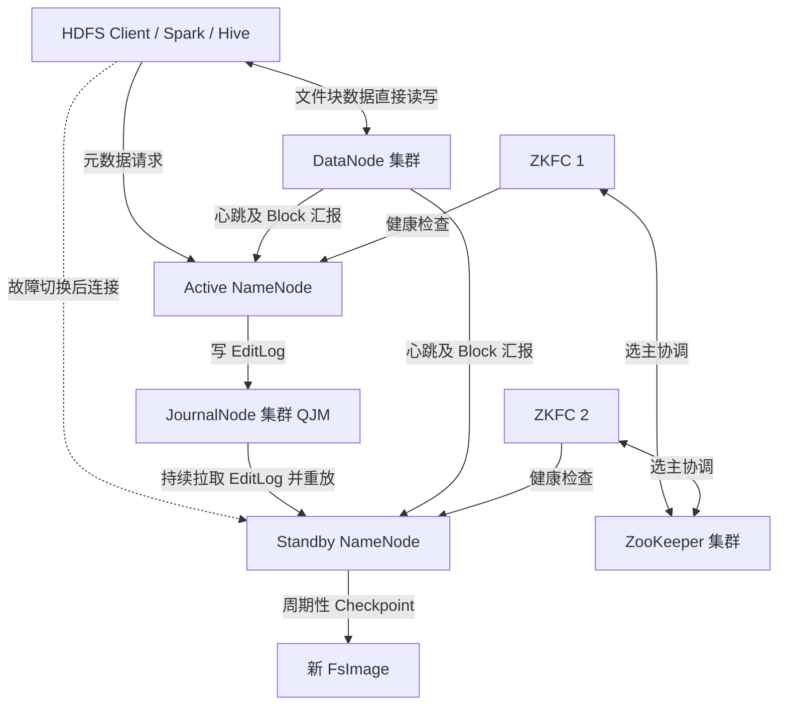
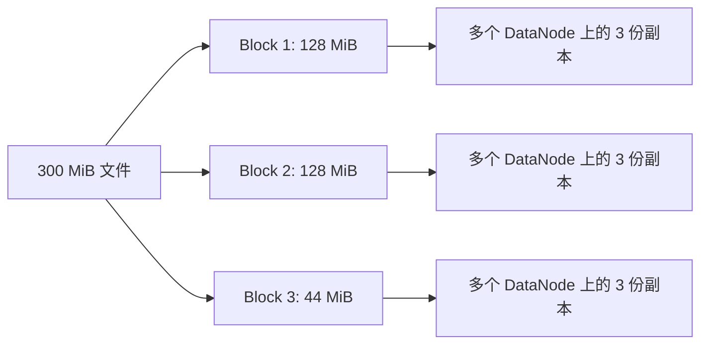
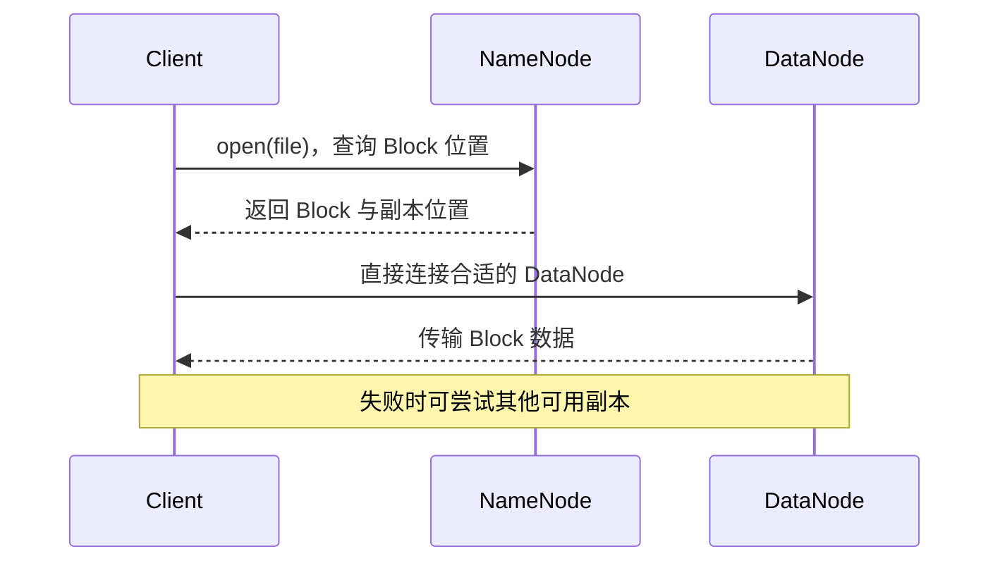
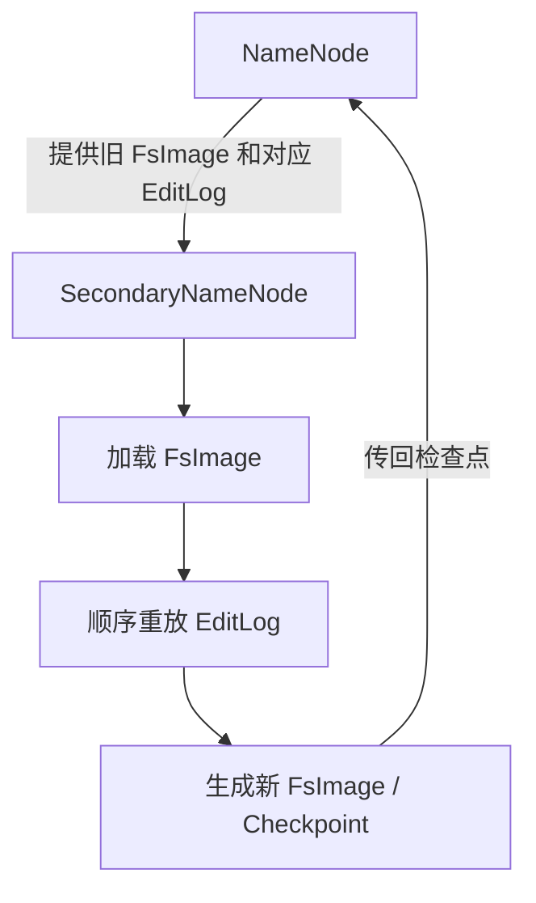
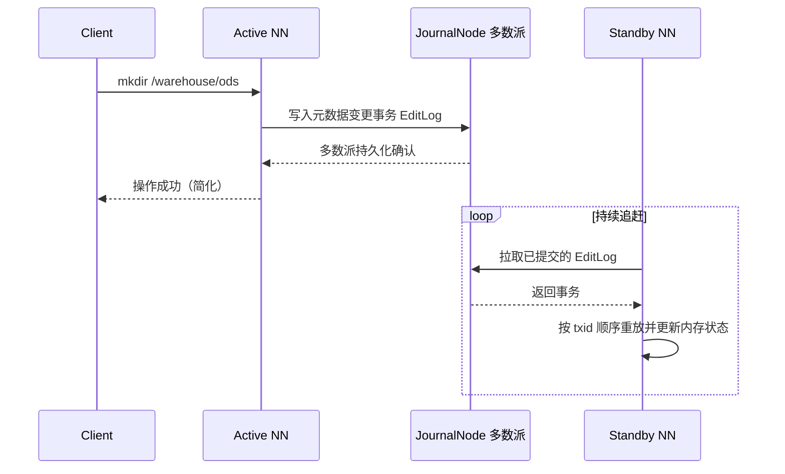
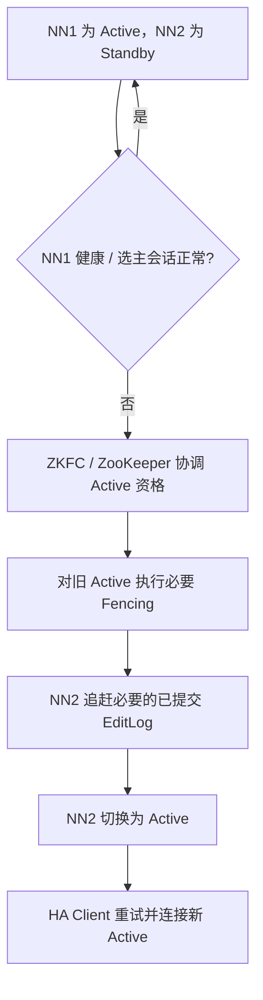
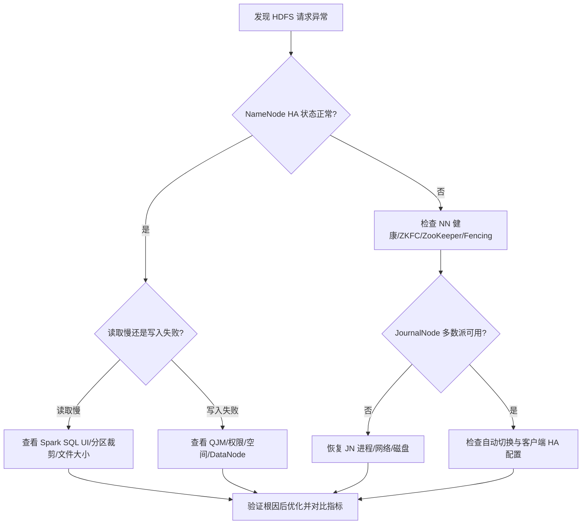

# HDFS 架构与可靠性工程｜HDFS Architecture & Reliability Engineering

> 面向数据平台建设、故障排查和日常运维。重点：**NameNode、DataNode、Block、FsImage、EditLog、Checkpoint、JournalNode、ZKFC、ZooKeeper、Fencing**。
>
> 本文以常见的 **HDFS 3.x、QJM（Quorum Journal Manager）共享编辑日志、双 NameNode 自动故障切换**为背景。不同发行版和配置可能存在差异。

## 1. 概述（Overview）

**问题背景**：HDFS 的可用性取决于两条相互独立的链路——元数据服务（NameNode）与数据块存储（DataNode 副本）。本专题围绕元数据链路的可靠性机制展开：Checkpoint、元数据同步与 HA 故障切换。

### 1.1 一张图看清全局



**三条不同的机制不要混淆：**

| 机制 | 解决什么问题 | 主要参与者 | 关键动作 |
|---|---|---|---|
| Checkpoint | 缩短元数据恢复时的日志重放过程 | 非 HA：SecondaryNameNode；HA：Standby NameNode | 生成新的 FsImage |
| 元数据同步 | 让 Standby 追赶 Active 的命名空间状态 | Active、JournalNode、Standby | 写 EditLog → 多数派确认 → 拉取重放 |
| HA 故障切换 | NameNode 故障时继续提供元数据服务 | ZKFC、ZooKeeper、NameNode、Fencing 机制 | 健康检查、选主、隔离、接管 |

## 2. HDFS 基础架构（Architecture）

**问题背景**：排障之前先明确"谁存什么"——混淆 NameNode 与 DataNode 的职责，是大多数 HDFS 误判的起点。

### 2.1 组件职责

| 组件 | 核心职责 | 不负责什么 |
|---|---|---|
| NameNode（NN） | 文件目录、权限、文件到 Block 的映射、Block 位置等元数据管理 | 不直接承载普通文件的数据流 |
| DataNode（DN） | 存储实际 Block；响应客户端读写；向 NN 发送心跳和 Block 汇报 | 不负责整个文件系统的命名空间管理 |
| Client | 向 NN 请求元数据，向 DN 传输实际文件块 | 不通过 NN 中转全部数据 |
| Block | 文件分布式存储的逻辑单位 | 不是 Spark Task，也不是 Parquet Row Group |

### 2.2 Block 计算

假设 Block 配置为 128 MiB，文件大小 300 MiB：

- Block 1：128 MiB
- Block 2：128 MiB
- Block 3：44 MiB
- **逻辑 Block 数 = ceil(300 / 128) = 3**。
- 若副本因子为 3，**总 Block 副本数 = 3 × 3 = 9**（包含每个 Block 的原始副本）。



> **易错点：** 一个 1 MiB 文件占用的实际数据空间通常不是 128 MiB。Block 大小是最大逻辑块尺寸，不是所有小文件都强制填满一个 Block。副本、校验和文件系统元数据另有开销。

### 2.3 HDFS 文件读取流程



读文件时 NameNode **提供元数据**，实际数据由 DataNode 传输。HA 保护的是元数据服务可用性，Block 副本保护的是数据块容错性，两者不同。

### 2.4 三种"日志/状态"别混为一谈

| 名称 | 保存什么 | 用来做什么 |
|---|---|---|
| FsImage | 某时刻的命名空间快照 | 恢复基线、Checkpoint |
| EditLog | 文件系统元数据变更事务 | 恢复增量、主备同步 |
| 服务运行日志 | 错误、警告、进程行为等 | 运维排障，不用于重放命名空间 |
| DataNode Block 汇报 | DataNode 当前保存的块及相关状态 | 帮助 NN 维护 Block 位置信息 |

## 3. Checkpoint：FsImage、EditLog 与检查点

**问题背景**：NameNode 重启或故障恢复时，需要从 FsImage 出发重放 EditLog 才能恢复命名空间；日志越长恢复越慢。Checkpoint 把某一事务位置之前的变更整合进新快照，正是为了缩短这段恢复过程。

### 3.1 三个概念

| 概念 | 含义 | 类比 |
|---|---|---|
| FsImage | 命名空间在某个事务位置的持久化快照 | 一次完整存档 |
| EditLog | 对命名空间的后续修改事务记录 | 增量操作流水 |
| Checkpoint | 把某一事务位置之前的变更整合进新快照 | 定期生成新版存档 |

假设旧 FsImage 已包含 `txid=1000` 的状态，而 EditLog 记录 `1001～5000`，完成 Checkpoint 后可以得到包含截至 `txid=5000` 状态的新 FsImage。

### 3.2 非 HA：SecondaryNameNode 的工作



工作过程（概念化）：

1. NameNode 正常处理元数据操作并持久化 EditLog。
2. SecondaryNameNode 按配置周期或日志规模触发 Checkpoint，协调滚动编辑日志并获取需要的文件。
3. 在自身内存中加载旧 FsImage、应用相应 EditLog。
4. 生成新的 FsImage，并将检查点交回 NameNode。
5. 以后恢复时可以从较新的 FsImage 开始，减少需要重放的日志。

**关键约束：SecondaryNameNode 不是备用 NameNode**——它不能在 NameNode 故障时自动变成 Active；Checkpoint 也不等于数据块备份。

### 3.3 HA：为什么通常不再有 SecondaryNameNode？

在标准 HDFS HA 架构中，**Standby NameNode 自身承担 Checkpoint**：它已持续重放共享 EditLog，维护了命名空间状态，可以基于该状态生成新的 FsImage，并按机制向 Active 提供检查点。

| 非 HA | HA |
|---|---|
| 单 NameNode + SecondaryNameNode（常见） | Active NN + Standby NN |
| SecondaryNameNode 执行 Checkpoint | Standby NN 执行 Checkpoint |
| SecondaryNameNode 无法自动接管 | Standby NN 可以经安全切换接管 |

**一句话：SecondaryNameNode 主要做检查点；Standby NameNode 同时具备日志追赶、检查点和故障接管能力。**

### 3.4 验证方法

- 在隔离测试环境观察 NameNode 存储目录中 `fsimage_` / `edits_` 文件的滚动与 txid 前进，确认 Checkpoint 按预期产生新快照。
- 使用 `hdfs haadmin -getServiceState`（见 6.1 节）确认 Active/Standby 状态与检查点行为一致。
- 注意：**Standby 持续拉取并重放 EditLog，但可能短暂落后**；接管前需要确保必要的已提交编辑日志得到应用。

## 4. QJM 与 JournalNode：共享编辑日志

**问题背景**：HA 双 NameNode 需要一份共享的编辑日志，作为 Standby 追赶与接管的一致依据。QJM（Quorum Journal Manager）用 JournalNode 多数派确认代替共享存储设备。

### 4.1 写入与追赶流程



**关键细节：** Standby 是持续自动追赶，而非每次都与 Active 同步到完全相同的瞬间；正常情况下可能有短暂延迟。接管前需要确保必要的已提交编辑日志得到应用。

JournalNode 存的是 **HDFS 命名空间的 EditLog**，不是应用运行日志、Spark 日志，也不是实际的文件 Block。

### 4.2 多数派（Quorum）规则

对于 `N` 台 JournalNode，写入所需最少成功确认数为：

\[
Q = \left\lfloor \frac{N}{2} \right\rfloor + 1
\]

| JN 总数 | 多数派 | 最多容忍的 JN 故障数 |
|---:|---:|---:|
| 3 | 2 | 1 |
| 5 | 3 | 2 |
| 7 | 4 | 3 |

例如 3 台 JN 中 1 台宕机，剩余 2 台仍可形成多数派；若 2 台宕机，仅剩 1 台，新的 EditLog 写入无法满足 QJM 的正常提交条件。

**关键约束：** JN 多数派判断的是 **EditLog 写入能否成功**，不是"Active 是否故障"的健康检测公式。ZooKeeper 集群自身也依赖法定多数，但它是另一套协调系统。

### 4.3 QJM 如何协助防止旧 Active 继续写？

JournalNode 使用 **epoch / 写入者隔离** 机制。新 Active 建立更高的写入 epoch 后，JournalNode 会拒绝旧 epoch 的写入，避免旧 Active 继续向共享 EditLog 提交过期事务。这是防止脑裂破坏元数据一致性的重要保护之一。

### 4.4 故障案例：JournalNode 多数派缺失

3 台 JN 仅剩 1 台时，新的元数据写操作一般无法正常提交；但**并不意味着 ZooKeeper 必然立即选出新的 Active**，因为换成另一个 NameNode 也无法凭空恢复 JournalNode 多数派。

对于已有文件的读取，若 NameNode 仍可提供元数据、DataNode 有可用 Block，读取**可能仍然成功**；实际结果取决于故障范围、NameNode 状态和具体操作。不要把"写日志失败"直接等同于"所有读请求立刻失败"。

### 4.5 验证方法

见 8.1 节的"单个 JN 故障 / 两个 JN 故障"实验：在隔离测试环境分别停止 1/3 与 2/3 的 JournalNode，观察 EditLog 写入状态与多数派行为是否与上表一致。

## 5. HA 自动故障切换与 Fencing（Failover & Fencing）

**问题背景**：Active NameNode 故障时，必须有人回答两个问题——"谁能接管"与"旧的 Active 如何隔离"。缺少协调与隔离，就可能出现双主（脑裂）破坏共享元数据。

### 5.1 组件分工

| 组件 | 具体职责 |
|---|---|
| ZKFC（ZooKeeper Failover Controller） | 监控本地 NN 健康；参与选主；组织故障切换、必要的隔离 |
| ZooKeeper | 通过会话和临时锁等机制协调谁有资格成为 Active |
| Standby NN | 追赶 EditLog、接管元数据服务 |
| Fencing | 防止旧 Active 在新 Active 接管后继续执行危险操作 |
| JournalNode | 通过 epoch 等机制拒绝过期写入者 |

### 5.2 自动故障切换流程



故障可能来自 NameNode 进程退出、健康检查失败、主机故障或 ZooKeeper 会话失效等。**ZooKeeper 不直接检查全部 NameNode 内部状态，也不亲自执行 Fencing**；ZKFC 的健康监控和选主逻辑共同参与判断。

**关键约束：** "失去 ZooKeeper 连接"不等于"NameNode 进程必然死亡"；故障切换也不保证零停顿，客户端通常需要重试。**HA 不等于零中断。**

### 5.3 脑裂（Split-Brain）为什么危险？

场景：NN1 仍活着且可访问部分服务，但与 ZooKeeper 失联；NN2 获得新的 Active 资格。若两者都继续接受写入，就可能发生双主冲突。

防护分层：

1. ZooKeeper 的锁与会话协调 Active 资格。
2. ZKFC 通过配置的 fencing 方法尝试隔离旧 Active（例如 sshfence，实际需正确配置）。
3. JournalNode 使用 epoch 拒绝过期 Active 的共享日志写入。
4. Standby 在提升前追赶必要的 EditLog，避免遗漏已提交事务。

### 5.4 验证方法

见 8.1 节"Active NN 故障"实验：在确认 Fencing 配置正确后，于隔离测试环境模拟 NN 进程故障，观察 ZKFC / ZooKeeper 选举、Fencing 日志、HA 状态与客户端重试是否符合 5.2 节流程。

## 6. 实际应用中可能出现的问题与排查手册（Incident Playbooks）

> 先收集证据，再决定是否切主、扩容或修改数据。不要把 HA 当成所有 HDFS 故障的万能修复手段。

### 6.1 HA 运维命令与配置认识

> 以下为典型示例，不可不经核对直接用于生产集群。

```bash
# 查看两个 NameNode 的 HA 状态（逻辑 NN ID 需以配置为准）
hdfs haadmin -getServiceState nn1
hdfs haadmin -getServiceState nn2

# 查看 NameNode 是否响应健康检查
hdfs haadmin -checkHealth nn1

# 查看 HDFS 报告（DataNode、容量等）
hdfs dfsadmin -report
```

常见配置项：

| 配置 | 用途 |
|---|---|
| `dfs.nameservices` | 定义逻辑 nameservice |
| `dfs.ha.namenodes.<nameservice>` | 定义 NameNode ID 列表 |
| `dfs.namenode.shared.edits.dir` | QJM 共享 EditLog 地址（如 `qjournal://...`） |
| `dfs.ha.automatic-failover.enabled` | 是否启用自动故障切换 |
| `ha.zookeeper.quorum` | ZooKeeper 集群地址 |
| `dfs.client.failover.proxy.provider.<nameservice>` | 客户端故障切换代理 |

配置细节、命令适用性与安全操作必须以所用 Hadoop 版本官方文档为准。

### 6.2 常见现象排查表

| 现象 | 优先核查 | 可能原因 | 处理方向 | 风险提示 |
|---|---|---|---|---|
| 客户端报 `StandbyException` | HA 逻辑 URI、客户端 failover proxy、NN 状态 | 客户端直连 Standby 或切换中 | 改用 nameservice URI、检查自动重试 | 不要盲目重启两台 NN |
| Active 不可达，Standby 未接管 | ZKFC 进程、ZooKeeper 会话、Fencing 日志 | 选举、健康检测或隔离失败 | 分层定位 ZKFC/ZK/NN | 禁止未经确认强制双主 |
| JN 3 台中 2 台失效 | JournalNode 进程、网络、磁盘、写入错误 | 失去 QJM 多数派 | 优先恢复 JN 多数派 | 切换 NN 不能恢复多数派 |
| NameNode 内存持续升高 | 文件/目录数、Block 数、GC、堆使用 | 小文件或命名空间增长 | 小文件治理、容量规划 | 不能只调大 Block 期待自动合并 |
| Spark 查询越来越慢 | SQL UI、文件大小分布、分区裁剪、Task、Shuffle | 小文件、数据倾斜、过度扫描 | 定位瓶颈后 Compaction/SQL 优化 | 文件数不等于 Task 数 |
| DataNode 下线、欠副本增加 | `dfsadmin -report`、NN Web UI、网络与磁盘 | DN 故障、容量不足 | 恢复节点、检查副本恢复 | 不要直接删除欠副本数据 |

### 6.3 故障诊断决策流程



### 6.4 真实运维中建议保留的证据

- **故障时间线**：开始时间、持续时间、受影响业务、恢复时间；统一时间与时区。
- **NameNode/ZKFC/JournalNode 日志**：健康检查、选主、Fencing、epoch、quorum 错误。
- **HDFS 指标**：Live/Dead DataNodes、UnderReplicatedBlocks、MissingBlocks、容量、NameNode JVM/GC、文件数与 Block 数。
- **计算层指标**：Spark SQL 执行计划、扫描文件数、Task 时间分布、Shuffle、I/O、Executor 资源。
- **操作审计**：变更配置、命令、操作者、回滚点；不要把密钥、内网主机信息提交到 GitHub。

## 7. 数据开发视角：小文件治理工程实践（Small-file Engineering）

**问题背景**：海量小文件会同时放大 NameNode 元数据、DataNode 本地文件开销与 Spark 扫描调度开销。治理前先量化分布，合并后用指标验证收益，而不是仅凭"文件多"下结论。

### 7.1 小文件的主要成本

- **NameNode：** 每个文件及其 Block 都有元数据，海量小文件增加内存和元数据管理压力。
- **DataNode：** 本地块文件、校验文件及读写操作也存在开销。
- **Spark：** 文件枚举、打开文件、读取器初始化、扫描分区规划以及可能的大量 Task 调度开销。

**注意：文件数 ≠ Block 数 ≠ Spark Task 数。** Spark SQL 可以把多个小文件打包到同一个扫描分区；Parquet 文件也可能被拆分扫描。

### 7.2 例题：20 GiB / 天，4,000 个 Parquet 文件

平均文件大小：

\[
20\times1024/4000=5.12\ \mathrm{MiB}
\]

若以约 128 MiB / 文件作为初步目标：

\[
20\times1024/128=160\ \text{个文件}
\]

文件数量预计从 4000 降到约 160（约减少 96%）。**160 是估算，不是必须值**：128 MiB 的 HDFS Block 大小不强制 Parquet 文件恰好 128 MiB。可以根据压缩比、查询并行度、文件格式和资源情况测试 128～512 MiB 等目标。

### 7.3 排查顺序

1. **HDFS：** 统计文件数量、大小分布、分区数量，检查 NameNode 指标。
2. **Spark SQL UI：** 看扫描文件数、扫描量、Task 数量、调度延迟、Executor CPU/I/O、Shuffle 与倾斜。
3. **SQL / Hive：** 检查分区裁剪、谓词下推、Join、表统计信息和执行计划。
4. **验证瓶颈：** 比较合并前后的查询耗时和资源使用，不能仅凭"文件多"就认定它是全部原因。

常用命令（路径按实际环境调整）：

```bash
hdfs dfs -count -h /warehouse/dwd/order_detail/dt=2026-10-21
hdfs dfs -ls -h /warehouse/dwd/order_detail/dt=2026-10-21
hdfs dfs -du -h /warehouse/dwd/order_detail/dt=2026-10-21
```

### 7.4 Spark 的 `coalesce` 与 `repartition`

| 操作 | 常见用途 | Shuffle | 代价与风险 |
|---|---|---|---|
| `coalesce(160)` | 减少分区数 | 默认通常不发生全量 Shuffle | 开销低，但可能出现分区大小不均、并行度不足 |
| `repartition(160)` | 重新分配数据、调整分区数 | 通常发生 Shuffle | 数据分布更易均衡，但网络、磁盘、CPU 成本更高 |

```python
# 示例：写入独立的临时目录，避免直接覆盖生产分区
source_df = spark.read.parquet("hdfs:///warehouse/dwd/order_detail/dt=2026-10-21")
source_df.repartition(160).write.mode("overwrite").parquet(
    "hdfs:///tmp/order_detail_compact_2026-10-21"
)
```

该示例仅演示重写文件，**并不是完整的生产分区替换流程**。实际还需要：临时目录 → 行数和关键指标核验 → 并发读写协调 → 安全切换分区位置/表快照 → 保留回滚能力 → 延迟清理旧数据。Iceberg、Delta Lake 等表格式可提供更完善的快照提交与 Compaction 机制。

### 7.5 小文件治理闭环

假设每日 **20 GiB**、**4,000** 个 Parquet 文件：平均 **5.12 MiB/文件**。若以 **128 MiB** 为估算目标，约需 **160** 个文件；以 **256 MiB** 为估算目标，约需 **80** 个文件。目标需要按实际压缩后大小、扫描并行度、查询模式验证，而非由 HDFS Block 大小机械决定。


**写入示例（演示环境）**：

```python
from pyspark.sql import SparkSession
spark = SparkSession.builder.appName("hdfs-compaction-lab").getOrCreate()
df = spark.read.parquet("hdfs:///lab/orders/dt=2026-10-21")
# 仅用于独立测试目录；repartition 会产生 Shuffle，数量不保证等于最终文件数
(df.repartition(80).write.mode("overwrite")
   .parquet("hdfs:///lab/staging/orders_compacted/dt=2026-10-21"))
```

**生产注意**：普通 Hive 外部表目录替换需要协调并发读写、校验和回滚；不要将此示例直接用于在线分区。Iceberg/Delta Lake 的快照提交和文件维护能力可以降低部分操作风险，但仍需按表格式和版本制定策略。

## 8. 可复现的实验场景（Lab Scenarios）

### 8.1 实验方案（仅隔离测试集群）

| 实验 | 操作思路 | 观察指标 | 预期现象 |
|---|---|---|---|
| 单个 JN 故障 | 在测试环境停止 1/3 JN | EditLog 写入、JN 日志 | 多数派仍可用，写入通常继续 |
| 两个 JN 故障 | 停止 2/3 JN | QJM 报错、元数据写操作 | 新的 EditLog 无法正常提交；部分已有文件读取可能成功 |
| Active NN 故障 | 在确认 Fencing 后模拟 NN 进程故障 | ZKFC/ZK、HA 状态、客户端重试 | Standby 经过安全切换接管 |
| 小文件治理 | 对测试分区合并 Parquet 文件 | 文件数、大小、查询时间、Task | 可能降低开销，但需实测 |

> **安全边界：这些实验只应在自建测试集群执行，故障注入仅限测试环境。** 不要在生产环境直接停止节点、强制切主或覆盖分区。自动切换不是零中断，客户端操作可能需要重试。

### 8.2 自测与复盘（以故障决策代替背诵）

1. 3 个 JournalNode 中 2 个故障，为什么简单切换 NameNode 无法恢复写入？
2. NN1 与 ZooKeeper 断连但仍可访问 JournalNode，为什么需要 Fencing 和 epoch？
3. HA 下为什么通常不需要 SecondaryNameNode？
4. 为什么 4,000 个 Parquet 文件不一定对应 4,000 个 Spark Task？
5. 某个分区文件合并后查询没有变快，你会继续检查哪些指标？
6. 如何设计 Compaction 的核验、切换和回滚流程？

<details><summary>复盘要点</summary>

1. QJM 多数派缺失，新 Active 也不能正常提交共享 EditLog。
2. 网络隔离可能使旧 Active 仍运行；Fencing 与 JN epoch 防止旧写入者破坏共享状态。
3. Standby 本身同步元数据并承担 Checkpoint。
4. Spark 文件扫描会打包小文件或拆分大文件，取决于格式与配置。
5. 检查分区裁剪、Join、Shuffle、倾斜、I/O 和缓存等因素。
6. 独立 staging → 校验 → 协调并发 → 安全切换 → 观察 → 保留回滚点。

</details>

## 9. 总结与参考资料（References）

### 9.1 核心结论

- **FsImage** 是命名空间快照；**EditLog** 是元数据变更事务。
- **Checkpoint** 生成新快照；非 HA 的 SecondaryNameNode 不是热备。
- **HA Standby** 持续重放 EditLog、执行 Checkpoint，并在安全切换后接管。
- **JournalNode/QJM** 保存共享编辑日志，多数派用于写入确认，**不是 NameNode 故障检测公式**。
- **ZKFC + ZooKeeper** 完成健康检查、选主协调；Fencing 和 JN epoch 降低脑裂风险。
- **HDFS HA、Block 副本、Spark 文件治理** 分别解决服务可用性、数据容错与处理效率问题。

### 9.2 官方资料与版本说明

- [Apache Hadoop: HDFS Architecture](https://hadoop.apache.org/docs/stable/hadoop-project-dist/hadoop-hdfs/HdfsDesign.html)
- [Apache Hadoop: HDFS HA with QJM](https://hadoop.apache.org/docs/stable/hadoop-project-dist/hadoop-hdfs/HDFSHighAvailabilityWithQJM.html)
- [Apache Hadoop: HDFS User Guide](https://hadoop.apache.org/docs/stable/hadoop-project-dist/hadoop-hdfs/HdfsUserGuide.html)
- [Apache Spark: SQL Performance Tuning](https://spark.apache.org/docs/latest/sql-performance-tuning.html)

> 适用范围：典型 Hadoop 3.x QJM HA 部署；实际命令、故障行为和配置以目标版本、环境及官方文档为准。
