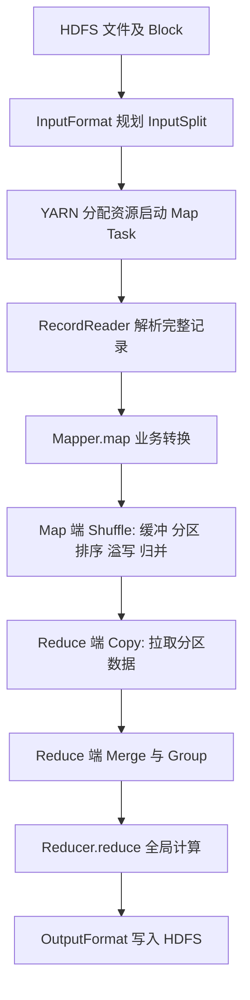
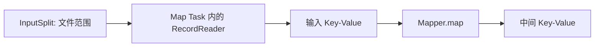
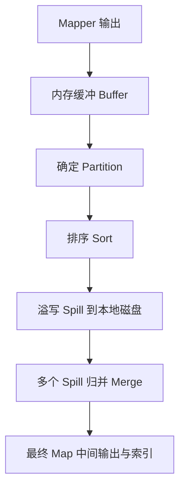
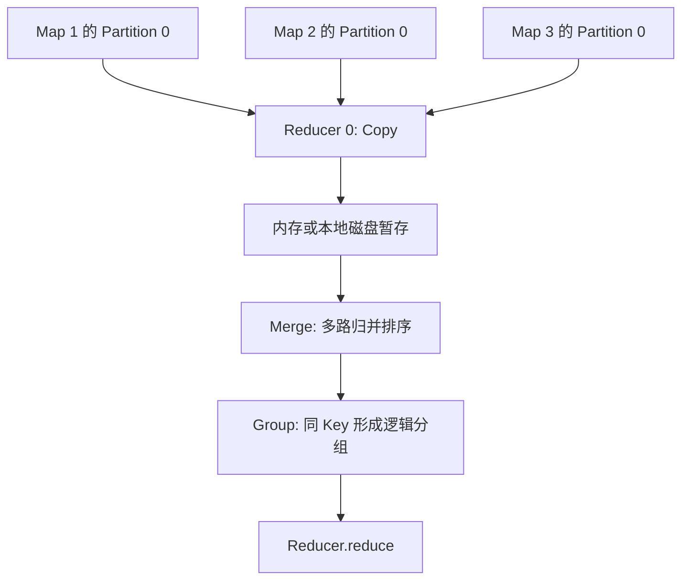
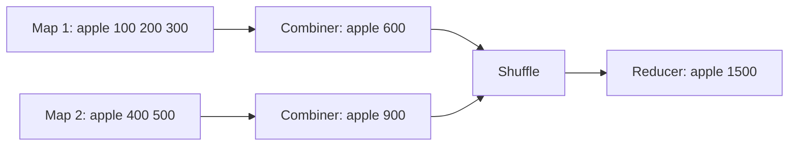
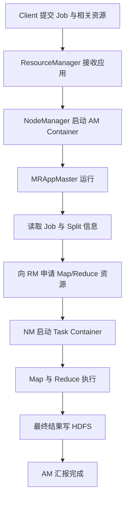

# MapReduce：从 HDFS 输入到 Shuffle 与 YARN 调度

> 面向数据平台学习与日常开发。重点：**InputSplit、RecordReader、Mapper、Map 端 Shuffle、Reduce 端 Shuffle、Combiner、数据倾斜、YARN**。
>
> 本文是 [HDFS 架构与可靠性工程](../hdfs-reliability/) 的后续学习笔记：HDFS 解决"数据存在哪里"，MapReduce 解决"数据怎么被并行计算"。以常见的 **Hadoop 3.x、YARN 资源调度** 为背景，不同发行版和配置可能存在差异。

## 1. 概述与一图总览

**问题背景**：HDFS 把大文件切成 Block 分散存储后，计算侧需要回答三个问题——任务以什么粒度并行（切片）、中间数据如何按 Key 重新组织（Shuffle）、计算资源由谁分配（YARN）。MapReduce 用一套固定的执行流水线回答了这三件事。

学习完成后，应能解释：HDFS 中的文件如何变成 Map Task 的输入；为什么 Block 不等于 InputSplit；Map 端与 Reduce 端 Shuffle 各做什么；Combiner 为什么能减少网络传输；数据倾斜为什么发生；YARN 如何调度 Job。



**核心认知**：HDFS 管存储；InputFormat 管输入规划与记录读取器创建；MapReduce 管计算逻辑；Shuffle 管数据重新分发与组织；YARN 管计算资源和任务运行。

MapReduce 是面向大规模数据的分布式批处理编程模型与执行框架。它将大数据拆成多个可以并行处理的任务（Map），按 Key 重新组织中间数据（Shuffle），再对同一 Key 的数据做聚合（Reduce）。适合大规模离线批处理，但对于低延迟交互式分析通常不如现代内存计算引擎灵活。

以商品销售额统计为例，原始订单：

```text
apple,100
banana,50
apple,200
orange,30
apple,300
```

Mapper 输出：`(apple,100)`、`(banana,50)`、`(apple,200)` 等。Shuffle 将相同商品归到同一 Reducer 的 Key 分组，Reducer 求和，输出 `(apple,600)`、`(banana,50)`、`(orange,30)`。

**注意**：Map 是局部数据处理，Reduce 是按 Key 的最终处理；并非每个作业都必须有 Reducer，Map-only Job 也存在。

## 2. 从 Block 到 InputSplit

### 2.1 Block：物理存储视角

HDFS 将文件划分成 Block 存储于 DataNode，并按配置保存副本。Block 解决的是"数据在哪里、怎样分布和容错"，不直接定义计算任务数。

假设文件大小为 300 MB，Block 大小为 128 MB，则文件的逻辑 Block 范围为 128 MB、128 MB、44 MB；每个 Block 可能有多个副本。这一机制在 [HDFS 专题](../hdfs-reliability/) 的基础架构一节有更详细的展开。

### 2.2 InputSplit：逻辑计算视角

InputSplit 描述某个 Map Task 应处理的输入范围，典型字段包括文件路径、起始偏移量、长度以及数据位置提示。**InputSplit 不是另一份数据副本**。

InputFormat 负责确定 InputSplit，并创建 RecordReader。对于典型 FileInputFormat，可用下面的规则理解切片目标大小：

```text
SplitSize = max(MinSize, min(MaxSize, BlockSize))
```

这不是所有 InputFormat 通用的公式，实际切片还取决于文件格式、是否可切分、剩余长度处理等。

在 300 MB 文件、128 MB 切片目标的典型示例中，可能生成 3 个 Split，对应 3 个 Map Task。但 **Block 与 InputSplit 并不强制一一对应**：一个 Split 可以跨 Block；一个 Block 对应的文件范围也可能被多个 Split 覆盖；多个小文件也可能由 CombineFileInputFormat 组合成较少的 Split。

> **关键约束**：把"一个 Block 对应一个 Map Task"当成永远成立的规则，是最常见的理解偏差。它只是默认配置下常见的结果，不是机制保证。

### 2.3 为什么不直接让 Mapper 读取 Block？

- Block 面向存储，而计算需要按输入格式决定任务粒度。
- 数据记录边界不一定与 Block 边界一致。
- 不同文件格式具有不同读取规则，例如文本按行、序列化记录按记录、不可切分压缩文件通常不能按任意偏移切分。
- InputSplit 可以附带位置提示，帮助调度器尽量实现数据本地性。

**典型小文件问题**：1000 个 1 MB 文本文件采用默认 TextInputFormat 时，通常会生成约 1000 个 Map Task，即使总数据只有约 1 GB。CombineTextInputFormat 可减少输入任务数，但不会自动合并 HDFS 中的物理小文件——HDFS 侧的小文件治理思路见 [HDFS 专题](../hdfs-reliability/) 的小文件工程实践一节。

## 3. RecordReader 与 Mapper 的区别



对 TextInputFormat，LineRecordReader 将文本按行解析为：

| 输入 Key | 输入 Value |
|---|---|
| 行首字节偏移量 | 一整行文本，例如 `apple,100` |

Mapper 再把文本解析成业务字段并输出 `(apple,100)`。因此 **RecordReader 负责正确读取记录，Mapper 负责业务计算**。两者都在 Map Task 执行过程中，但 RecordReader 不等于 `map()`。

如果一行跨越 InputSplit 边界，LineRecordReader 会协调跳过非首切片的残余行，并允许前一切片读取至完整行结束，避免典型文本场景下的重复与遗漏。

数据本地性：Map Task 不需要把所有 Block 预先复制到所在机器。可在本地读取已有副本，或通过 HDFS Client 从远程 DataNode 流式读取。

## 4. Map 端 Shuffle：为什么要先整理？

### 4.1 核心动机

如果 Mapper 每产生一条 Key-Value 就单独通过网络发给 Reducer，会导致高昂的通信和管理开销。Hadoop 通常先将中间结果缓冲、分区、排序、溢写和归并，供 Reducer 批量拉取。



上图是逻辑理解顺序，不是严格的逐行执行时序。实际实现中，分区在收集输出时已确定，排序、溢写与可选 Combiner 在相应阶段协同进行。

### 4.2 每个步骤解决什么问题？

| 机制 | 目的 | 易错点 |
|---|---|---|
| Buffer | 批量暂存中间结果，减少频繁 I/O | 不代表所有输出始终在内存中 |
| Partition | 决定 Key 对应哪个 Reducer | 不是按 Map Task 分配 Reducer |
| Sort | 使分区内相同 Key 相邻 | 排序不是业务求和 |
| Spill | 缓冲达到阈值时写本地磁盘 | Spill 通常不是写 HDFS |
| Merge | 归并同一 Map Task 的多个 Spill 文件 | 不是跨 Mapper 的全局归并 |

> **关键约束**：Map 端 Merge 是**同一个 Map Task 自己的多个 Spill 文件**之间的归并，排序合并发生在任务内部；它不是跨 Mapper 的聚合，不同 Mapper 的数据要到 Reduce 端才会汇总。

常见配置：`mapreduce.task.io.sort.mb`（常见默认 100 MB）与 `mapreduce.map.sort.spill.percent`（常见默认 0.8），实际以集群版本与配置为准。

默认 HashPartitioner 通常按如下思路分区：

```java
(hash(key) & Integer.MAX_VALUE) % numReduceTasks
```

相同 Key 会进入同一分区（假设默认分区与分组语义），但不同 Key 也可能进入同一分区。

## 5. Reduce 端 Shuffle：Copy → Merge → Group



1. **Copy**：Reducer 从各个 Map Task 的最终输出中拉取属于自己的 Partition，而不是仅请求某个特定 Key。即使某个 Map 没有 `apple`，只要它的对应分区包含其他 Key，也可能需要拉取。
2. **Merge**：每个 Map 输出内部已排序，但不同 Map 的输出仍是独立有序流，需要多路归并。根据数据量可在内存和本地磁盘分阶段进行。
3. **Group**：同一 Key 的 Value 被组织为逻辑分组，如 `(apple, [100,200,300])`；并不要求先创建装有全部 Value 的 Java List。
4. **Reduce**：执行用户编写的聚合逻辑，如 SUM、COUNT、MAX，并通过 OutputFormat 写入 HDFS。

**重要执行细节**：Reduce 的 Copy 阶段可以在部分 Map 完成后开始，并非必须等所有 Mapper 都结束。

### 5.1 Map 端 Merge 与 Reduce 端 Merge 不同

| 对比项 | Map 端 Merge | Reduce 端 Merge |
|---|---|---|
| 归并对象 | 一个 Map Task 自己的多个 Spill 文件 | 来自多个 Map Task 的分区数据 |
| 归并目的 | 减少最终中间输出文件数 | 形成全局有序的 Key 流供分组 |
| 数据来源 | 本地磁盘 | 网络拉取的各 Map 输出 |

**广义 Shuffle** 包括 Map 端准备、Reduce 端网络拉取和归并分组；有些资料将 Shuffle 狭义地指网络数据交换。

## 6. Combiner 与数据倾斜

### 6.1 Combiner：局部聚合，减少 Shuffle 数据量

Combiner 在 Map 端尝试对相同 Key 做局部聚合。例如每个 Map 有大量 `(apple,金额)`，可先输出局部 `SUM`，使网络传输从大量明细减少为少量汇总。



> **关键约束**：Hadoop **不保证 Combiner 一定执行、执行一次或只执行一次**；它可能在 Spill 或 Merge 中调用。因此有无 Combiner 都必须得到相同最终结果。Combiner 是性能优化，不是业务正确性的前提。

| 聚合 | 能否直接对局部结果再次聚合 | 说明 |
|---|---|---|
| SUM | 可以 | 局部和再求和 |
| COUNT | 可以（用局部计数求和） | 计数值作为可合并中间状态 |
| MIN / MAX | 可以 | 局部最小/最大再取最小/最大 |
| AVG | 不能直接平均局部平均值 | 需要传 `(sum,count)`，最后 `sum/count` |

例：Map 1 为 `[10,20]`，局部均值 15；Map 2 为 `[30,40,50,60]`，局部均值 45。直接平均得到 30，实际全局平均为 35。正确中间状态是 `(30,2)` 与 `(180,4)`，最终 `(30+180)/(2+4)=35`。

### 6.2 数据倾斜：为什么 99% 任务完成仍然很慢？

数据倾斜是不同 Reducer 或任务承担的数据量、处理复杂度严重不均。例如 1000 万条订单中 `apple` 占 900 万条，默认同 Key 同分区，负责 `apple` 的 Reducer 可能成为瓶颈。

**为什么增加 Reducer 未必有用**：将 Reducer 从 10 个增加到 100 个，并不会自动将单个热点 Key 拆给 100 个 Reducer——默认分区规则仍会让同一 Key 进入同一 Reducer。

典型优化策略：

1. **优先识别计算类型**：SUM、COUNT 等可合并聚合优先考虑 Combiner，减少中间记录与网络传输。
2. **两阶段聚合 / Key 加盐**：将热点 `apple` 变为 `0_apple`、`1_apple`、`2_apple` 等，第一阶段分散局部聚合，第二阶段去盐后再次聚合。通常需要两个 Job 或两个聚合阶段；盐值分散效果受分区策略影响。
3. **检查分区策略**：如果多个不同 Key 碰撞到一个 Reducer，可调整分区方案与并行度。
4. **观察真实瓶颈**：Shuffle Bytes、任务时长、Spill、GC、网络与节点状态。慢任务不一定全是数据倾斜。

## 7. YARN：MapReduce Job 由谁调度运行？

| 组件 | 职责 |
|---|---|
| Client | 准备并提交作业、配置与相关资源 |
| ResourceManager（RM） | 集群级资源管理与调度 |
| NodeManager（NM） | 节点级 Container 启动、监控与资源状态汇报 |
| ApplicationMaster（MRAppMaster） | 单个 MapReduce Job 的任务协调、资源申请、重试管理 |
| Container | 分配给进程的 CPU、内存等资源执行环境，不等于 Docker |



实际提交过程中，Client 通常提前准备作业配置、Jar 与切片信息并放置到 HDFS 供 AM 使用；Reduce Copy 可以与尚在执行的 Map 阶段重叠。

**Map Task 数量不等于并发任务数**：例如 200 个 InputSplit 通常对应 200 个 Map Task；如果当前资源只能同时运行 20 个任务，则需要分批调度。RM 分配资源，AM 协调本 Job 的任务，NM 在节点上启动和监控 Container。

## 8. 综合案例与概念对照

### 8.1 完整案例：统计商品销售额

假设输入被划为三个 Split，各 Map Task 通过 RecordReader 读取订单行并由 Mapper 输出：

```text
Map 1: (apple,100), (banana,50), (apple,200)
Map 2: (apple,300), (orange,30)
Map 3: (apple,400), (banana,20)
```

1. **InputFormat** 规划 Split；YARN 启动对应 Map Task。
2. **RecordReader** 按行读取，Mapper 将文本转换成 `(product,amount)`。
3. **Map 端 Shuffle** 将输出缓冲、分区、排序、溢写、归并；若配置安全的 Combiner，可提前局部求和。
4. **Reduce Copy** 从所有 Map 输出中拉取对应 Partition。
5. **Reduce Merge/Group** 把同一 Key 的所有 Value 组织到一起。
6. **Reducer** 最终求和：`apple=1000`、`banana=70`、`orange=30`。
7. **OutputFormat** 将结果写入 HDFS 输出目录。

> 同一 Key 的数据必须被送到同一个 Reducer（在此普通分组聚合案例中）；**不同 Mapper 的数据不是在 Map 端 Merge 时就全局汇总**——Map 端 Merge 只整理单个任务自己的 Spill 文件。

### 8.2 与 SQL Server、Spark 的概念联系

| MapReduce | 相关 SQL/ETL 思维 | Spark 对应概念 |
|---|---|---|
| InputSplit / Map Task | 并行抽取范围与工作单元 | 输入分区 / Task |
| RecordReader | 数据源读取与记录解析 | 数据源扫描/解码 |
| Mapper | 清洗、映射、过滤 | map、filter 等转换 |
| Partition | 按业务 Key 重新分发 | partitioner / repartition |
| Combiner | 局部预聚合 | map-side combine、reduceByKey 的局部聚合 |
| Shuffle | 分布式数据交换 | Shuffle |
| Reducer | GROUP BY 聚合 | 聚合算子中的全局合并阶段 |

注意：SQL Server 不一定采用 MapReduce 的执行机制，Spark 也有独立的执行引擎；此表强调概念上的联系。

## 9. 常见易错点对照表

| 常见误解 | 正确理解 |
|---|---|
| Block = InputSplit，一一对应 | 前者是存储单位，后者是逻辑计算范围；不强制一一对应 |
| Map Task 就是 Mapper | 前者是任务执行单元，后者是任务内部的业务处理逻辑 |
| RecordReader 就是 Mapper | 前者解析完整记录，后者处理业务字段 |
| Partition 就是 Group | 前者决定目标 Reducer，后者在 Reduce 端按 Key 形成逻辑分组 |
| Map 端 Merge 会跨 Mapper 汇总 | 只合并本任务自己的本地 Spill；跨 Mapper 归并发生在 Reduce 端 |
| Shuffle 只是网络传输 | 广义 Shuffle 还包含 Map 端整理与 Reduce 端归并分组 |
| Combiner 必定执行 | 不保证执行、执行一次或只执行一次；结果必须与不执行时一致 |
| 增加 Reducer 数就能解决热点 Key | 默认分区仍把同一 Key 送入同一 Reducer |
| Map Task 数就是同时运行的任务数 | 并发受 YARN 资源约束，需分批调度 |
| Map 中间结果直接写 HDFS | 典型 Reduce Job 的 Map 输出保存在本地磁盘供 Shuffle 拉取 |

## 10. 自测与复盘

以下问题先自己回答，再展开对照答案。

<details><summary>Q1：300 MB 文件、128 MB Block 是否一定产生 3 个 Map Task？</summary>

不一定；取决于 InputFormat、切片大小、文件格式与切分能力等。典型可切分文本场景可能为 3 个。

</details>

<details><summary>Q2：一个 InputSplit 跨两个 Block，是否必须把两个 Block 完整复制到计算节点？</summary>

不需要；可以经 HDFS Client 本地或远程流式读取。

</details>

<details><summary>Q3：RecordReader 与 Mapper 的区别？</summary>

RecordReader 将输入范围解析为完整 Key-Value 记录；Mapper 对记录做业务转换。

</details>

<details><summary>Q4：为什么 Map 端已经 Sort/Merge，Reduce 端还要 Merge？</summary>

Map 端只保证各自输出有序；Reduce 端需要归并来自多个 Mapper 的独立有序流。

</details>

<details><summary>Q5：只有 8 个 Map 输出了 apple，Reducer 是否只从这 8 个 Map 拉取数据？</summary>

不一定；它拉取的是所有 Map 输出中属于其负责 Partition 的数据，其他 Key 也可能在该分区。

</details>

<details><summary>Q6：Combiner 能否直接计算 AVG？</summary>

不能直接对局部平均值再平均；应使用 `(sum,count)` 中间状态。

</details>

<details><summary>Q7：为什么增加 Reducer 不一定解决 apple 热点 Key？</summary>

默认分区仍把同一 Key 送入同一 Reducer，可考虑局部聚合、加盐两阶段聚合等。

</details>

<details><summary>Q8：200 个 Map Task，只有 20 个并发资源会怎样？</summary>

分批调度；任务数不等于并发数。RM 负责资源调度，AM 负责本 Job 协调，NM 负责节点执行环境。

</details>

## 11. 总结与学习路线

**一句话复盘**：HDFS 存数据；InputFormat 切分计算范围；RecordReader 读取记录；Mapper 产生中间结果；Map 端 Shuffle 整理本地输出；Reduce 端 Shuffle 拉取并按 Key 归并分组；Reducer 聚合；YARN 调度这一切的计算资源。

下一阶段学习方向（尚未展开）：

- MapReduce 失败重试、任务容错、推测执行（Speculative Execution）。
- Job History、YARN UI、Shuffle Bytes、Spill、GC、慢任务定位。
- Hadoop MapReduce 与 Spark 执行模型的对比。
- Spark RDD、DAG、Stage、窄依赖与宽依赖、Shuffle——这也是本学习路径的下一章。
