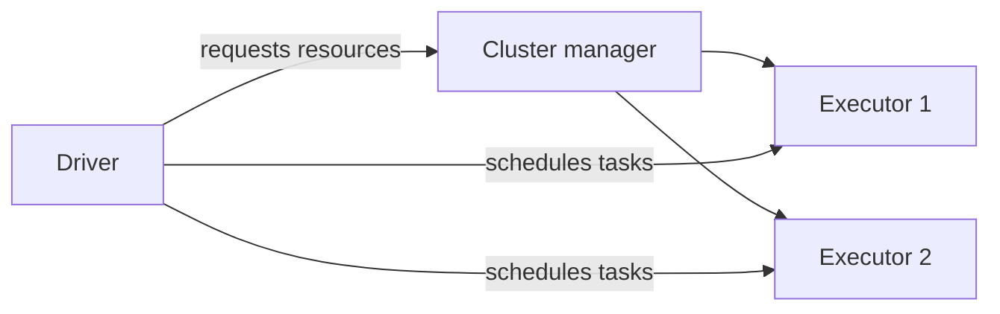
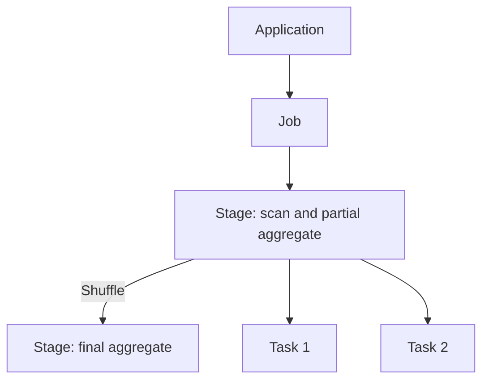
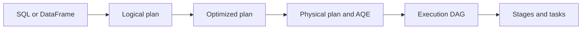
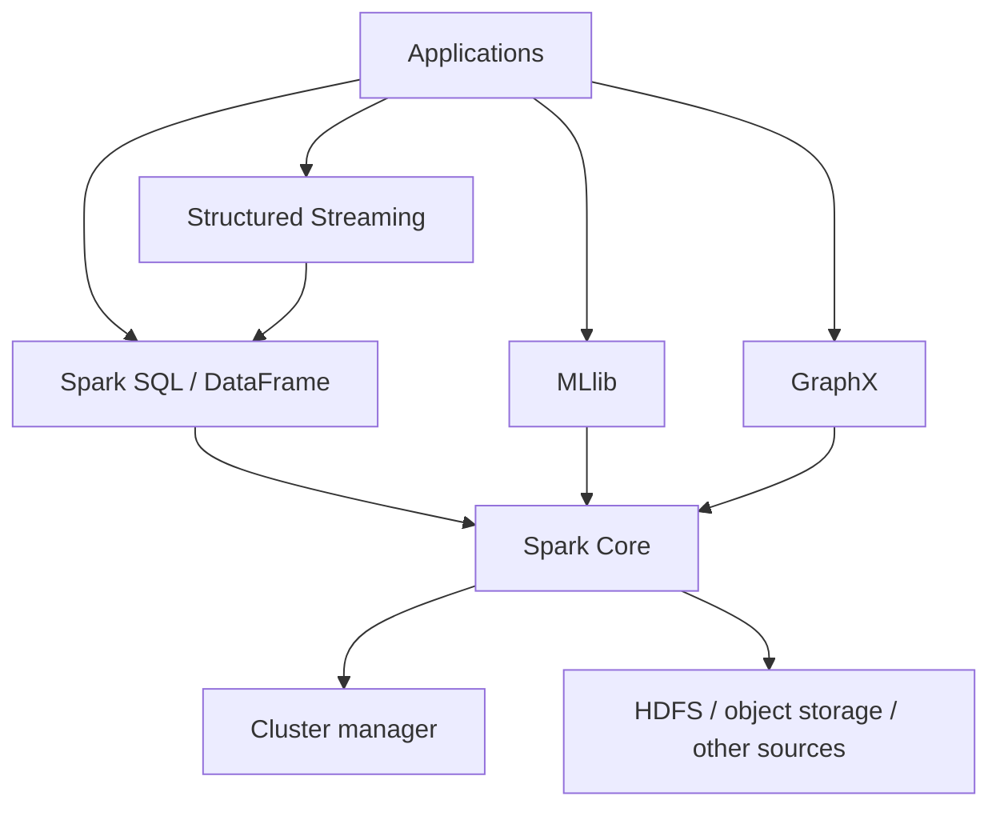
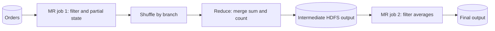
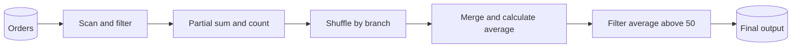
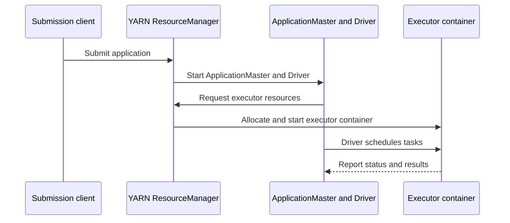

# Spark Lesson 1: From Hadoop to Distributed Execution

## 1. Where Spark fits
HDFS stores data, YARN manages resources, and MapReduce and Spark provide computation. Spark can use HDFS and YARN; compare it with the MapReduce engine rather than the whole Hadoop ecosystem. Spark Core provides execution fundamentals, Spark SQL handles structured data, Structured Streaming handles streams, MLlib provides machine learning, and GraphX supports graph computation.

## 2. Architecture and scheduling
The Driver runs application logic and schedules work; the cluster manager allocates resources; Executors run tasks, cache data and report status. A partition is a unit of data parallelism.

An application can contain multiple jobs. A job is divided into stages by dependencies; each stage contains tasks, typically one per partition. Failed tasks can be retried. Transformations such as `filter` usually build a lazy plan; actions such as `show`, `count` and writes trigger computation, but one action does not necessarily mean exactly one job. Shuffle dependencies commonly define stage boundaries; actual stage counts depend on the plan.


## 3. Understanding shuffle with AVG
```sql
SELECT branch_id, AVG(amount)
FROM orders WHERE status = 'PAID'
GROUP BY branch_id;
```
Each partition filters its records and calculates a partial sum and count per branch. Spark shuffles these states by branch, merges them and divides. A partial result is not the global answer.

| Partition | Amounts | Sum | Count | Local average |
|---|---|---:|---:|---:|
| P1 | 10, 20, 30 | 60 | 3 | 20 |
| P2 | 100 | 100 | 1 | 100 |

Averaging local averages gives 60, which is incorrect. The correct answer is (60+100)/(3+1)=40. SQL AVG ignores NULL and returns NULL for an all-NULL group. Floating-point rounding can vary; consider decimal for money.

## 4. Spark and MapReduce
Chained MapReduce jobs often write one job's output to HDFS before another reads it. Spark can pipeline narrow operations without writing every step to HDFS; grouping across partitions still requires shuffle, which commonly writes local files and may spill to disk. A MapReduce combiner can also aggregate locally when applicable and is not guaranteed to run. Caching must be requested; uncached data may be recomputed. Speed depends on data, resources and the plan.

## 5. Catalyst and DAG
Catalyst analyzes SQL/DataFrame logical plans, applies optimization rules and may use statistics to choose a physical plan. AQE can revise parts of the plan using runtime statistics. Execution dependencies form a DAG; the scheduler creates stages based on dependencies and shuffle. This uses rules and algorithms, not AI. RDDs do not follow the same SQL Catalyst optimization path.


## 6. Deployment
Local uses local threads; Standalone uses Spark's cluster manager; YARN and Kubernetes manage their own resources. Client and cluster describe driver placement: client runs the driver on the submitting host, cluster runs it inside the cluster. On YARN in cluster mode the driver runs in the ApplicationMaster process; in client mode it remains on the submitting host.
```bash
spark-submit --master yarn --deploy-mode cluster app.py
```

## 7. Small files and skew
Many small files increase metadata, listing and open overhead and may create many small tasks; Spark can combine files into scan partitions. Skew means unusually large keys or partitions cause stragglers; small files do not necessarily cause key skew. Compare task times, input, shuffle and spill in the Spark UI. Compact files or adjust partitions: `coalesce` commonly reduces partitions without a full shuffle, while `repartition` shuffles. For skew consider partial aggregation, a suitable broadcast join, or salting hot keys followed by a second aggregation; AQE addresses only some skew cases.

## 8. Lab
Run in a configured PySpark environment:
```python
from pyspark.sql import SparkSession, functions as F
spark = SparkSession.builder.master('local[2]').appName('SparkLesson').getOrCreate()
spark.conf.set('spark.sql.shuffle.partitions', '2')
rows = [('A', 10.0, 'PAID'), ('A', 20.0, 'PAID'), ('A', 30.0, 'PAID'), ('A', 100.0, 'PAID'), ('B', 50.0, 'PAID'), ('B', None, 'PAID'), ('B', 999.0, 'CANCELLED')]
df = spark.createDataFrame(rows, ['branch_id', 'amount', 'status']).repartition(2)
result = df.filter(F.col('status') == 'PAID').groupBy('branch_id').agg(F.avg('amount').alias('avg_amount'))
result.explain('formatted')
result.orderBy('branch_id').show()  # A = 40, B = 50
input('Inspect Spark UI (usually http://localhost:4040); press Enter to exit: ')
spark.stop()
```
Find filtering, partial aggregation, Exchange and final aggregation in the plan; inspect jobs, stages and shuffle in the UI. `repartition` itself introduces a shuffle. Tiny data cannot establish production performance.

## 9. Questions and answers
- **How can distributed data be processed early?** Each partition computes mergeable state before cross-partition merging.
- **Is everything in memory?** No; shuffle and spill can use disk.
- **Do more partitions always fix skew?** No; a hot key may remain concentrated.
- **Does a DAG require AI?** No; Spark uses dependencies and planning rules.

## Lesson 1 supplement A: Spark components

Functional components answer what Spark can do; Driver, Executor and Cluster Manager describe who performs the work.

| Layer | Component | Responsibility |
|---|---|---|
| Execution | Spark Core | Scheduling, memory management and recovery; RDD is a foundational abstraction |
| Structured data | Spark SQL | SQL, DataFrames, optimization and data sources |
| Streaming | Structured Streaming | Continuous processing using structured APIs; guarantees depend on source and configuration |
| Machine learning | MLlib | Feature processing, algorithms and pipelines |
| Graphs | GraphX | Graph-parallel computation, primarily through Scala APIs |
| Resources | Standalone / YARN / Kubernetes | Allocate resources; they do not implement business logic |



This is a conceptual diagram, not a complete dependency map. Applications can combine components; source capabilities affect execution.

## Lesson 1 supplement B: Comparing workflows

Consider paid-order averages per branch, followed by a filter for averages above 50. These diagrams illustrate one multi-job MapReduce implementation and one Spark implementation; neither is the only possible implementation or a benchmark.




| Aspect | Multi-job MapReduce example | Spark example |
|---|---|---|
| Input | Each job reads input; later jobs may read previous output | Tasks read input partitions |
| Grouping | Map output shuffles to reducers; a combiner may help | Partial aggregation then shuffle to final aggregation |
| Between steps | Job 1 writes HDFS output which job 2 reads | Narrow operators can pipeline without writing every step to HDFS |
| Disk | Map output and shuffle use disk; output can go to HDFS | Shuffle commonly uses local disk; spill is possible; final output goes to storage |
| Reuse | Materialized output can be reused | Explicit cache or persist; uncached data may be recomputed and cache may be evicted |
| Recovery | Persisted output and task retries | Task retries and lineage among other mechanisms |

Spark does not know the global average before data from partitions is combined and does not avoid all disk writes. One MapReduce job can also filter, aggregate and filter the final average in its reducer. The second job illustrates materialization between jobs, not a requirement for this SQL.

### Trace the partial states

P1 has A values 10, 20, 30 and B value 50; P2 has A value 100. P1 emits A `(60,3)` and B `(50,1)`; P2 emits A `(100,1)`. After shuffle the A task merges `(60,3)` and `(100,1)` into `(160,4)`, giving 40. These are mergeable states, not the global answer. If every key is distinct, local aggregation might not significantly reduce traffic. `COUNT(amount)` ignores NULL, while `COUNT(*)` counts rows; type, overflow and rounding also matter.

## Lesson 1 supplement C: Execution, deployment and scheduling

Three different questions are often confused: (1) the execution environment or cluster manager determines where resources come from; (2) client or cluster deploy mode determines where the Driver runs, subject to manager and language support; (3) FIFO or FAIR determines how concurrent jobs within one SparkContext compete for resources.

| Mode or policy | Use and key point |
|---|---|
| Local | Learning on one machine; `local[2]` uses two local worker threads |
| Standalone | Spark's built-in cluster manager |
| YARN | Hadoop resource management; ApplicationMaster coordinates resources |
| Kubernetes | Driver and Executors run on Kubernetes with suitable configuration |
| FIFO | Default within a Spark application: earlier jobs have priority; distinct from YARN queue scheduling |
| FAIR | Shares resources more fairly among concurrent jobs or pools; shares depend on configuration and availability |

YARN cluster mode, simplified:


The NodeManager also participates in container launch. In client mode the Driver stays on the submitting host while ApplicationMaster coordinates YARN resources; losing the client can affect the application.

```python
# Set before SparkContext creation
from pyspark.sql import SparkSession
spark = (SparkSession.builder.appName('FairSchedulingExample')
         .config('spark.scheduler.mode', 'FAIR').getOrCreate())
```

FAIR does not automatically change a job's task count or replace YARN queue scheduling. Concurrent jobs require the application to submit work concurrently; consult documentation for your versions.

## Lesson 1 supplement D: Check your understanding

**Exercise 1:** P1 contains A values 2 and 4; P2 contains A value 9. Find partial states and global average.  
**Answer:** `(6,2)` and `(9,1)` merge into `(15,3)`, giving 5. Averaging 3 and 9 incorrectly gives 6.

**Exercise 2:** If a computation has two stages, does it necessarily have one job?  
**Answer:** No. Stages belong to jobs, but one action may produce multiple jobs; inspect Spark UI.

**Exercise 3:** Many files and one hot key occur together. What should be investigated?  
**Answer:** Measure file and task overhead during scans, and task data sizes and duration after shuffle for key skew.

**Explore:** After the lab, compare SQL and Stages tabs, Exchange, shuffle read/write and task durations. Change input size or partition count and record results; tiny samples do not establish production speed.

> Later lessons can explore RDDs and DataFrames, shuffle internals, memory and caching, SQL tuning and streaming. This first lesson supplies the foundation.


## Official references
- [Cluster overview](https://spark.apache.org/docs/latest/cluster-overview.html)
- [RDDs and shuffle](https://spark.apache.org/docs/latest/rdd-programming-guide.html)
- [SQL tuning and AQE](https://spark.apache.org/docs/latest/sql-performance-tuning.html)
- [Running on YARN](https://spark.apache.org/docs/latest/running-on-yarn.html)
- [Spark UI](https://spark.apache.org/docs/latest/web-ui.html)
- [NULL semantics](https://spark.apache.org/docs/latest/sql-ref-null-semantics.html)

- [Job scheduling](https://spark.apache.org/docs/latest/job-scheduling.html)
- [Spark documentation](https://spark.apache.org/docs/latest/)

