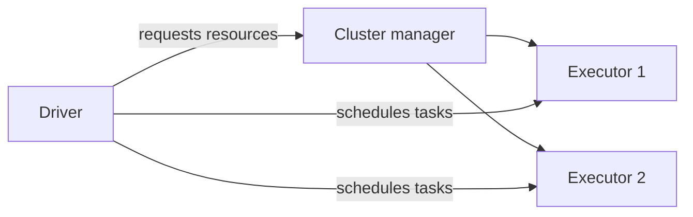
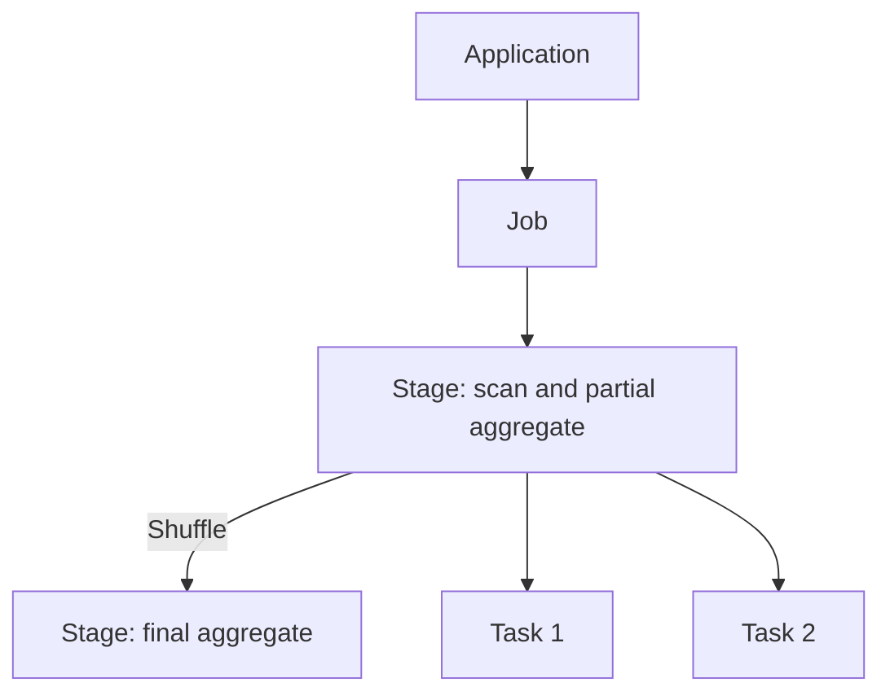
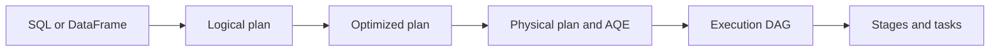

# Spark Fundamentals: From Hadoop to Distributed Execution

## 1. Where Spark fits
HDFS stores data, YARN manages resources, and MapReduce and Spark provide computation. Spark can use HDFS and YARN; compare it with the MapReduce engine rather than the whole Hadoop ecosystem. Spark Core provides execution fundamentals, Spark SQL handles structured data, Structured Streaming handles streams, MLlib provides machine learning, and GraphX supports graph computation.

## 2. Architecture and scheduling
The Driver runs application logic and schedules work; the cluster manager allocates resources; Executors run tasks, cache data and report status. A partition is a unit of data parallelism.

An application can contain multiple jobs. A job is divided into stages by dependencies; each stage contains tasks, typically one per partition. Failed tasks can be retried. Transformations such as `filter` usually build a lazy plan; actions such as `show`, `count` and writes trigger computation, but one action does not necessarily mean exactly one job. Shuffle dependencies commonly define stage boundaries; actual stage counts depend on the plan.


## 3. Understanding shuffle with AVG
```sql
SELECT branch_id, AVG(amount)
FROM orders WHERE status = 'PAID'
GROUP BY branch_id;
```
Each partition filters its records and calculates a partial sum and count per branch. Spark shuffles these states by branch, merges them and divides. A partial result is not the global answer.

| Partition | Amounts | Sum | Count | Local average |
|---|---|---:|---:|---:|
| P1 | 10, 20, 30 | 60 | 3 | 20 |
| P2 | 100 | 100 | 1 | 100 |

Averaging local averages gives 60, which is incorrect. The correct answer is (60+100)/(3+1)=40. SQL AVG ignores NULL and returns NULL for an all-NULL group. Floating-point rounding can vary; consider decimal for money.

## 4. Spark and MapReduce
Chained MapReduce jobs often write one job's output to HDFS before another reads it. Spark can pipeline narrow operations without writing every step to HDFS; grouping across partitions still requires shuffle, which commonly writes local files and may spill to disk. A MapReduce combiner can also aggregate locally when applicable and is not guaranteed to run. Caching must be requested; uncached data may be recomputed. Speed depends on data, resources and the plan.

## 5. Catalyst and DAG
Catalyst analyzes SQL/DataFrame logical plans, applies optimization rules and may use statistics to choose a physical plan. AQE can revise parts of the plan using runtime statistics. Execution dependencies form a DAG; the scheduler creates stages based on dependencies and shuffle. This uses rules and algorithms, not AI. RDDs do not follow the same SQL Catalyst optimization path.


## 6. Deployment
Local uses local threads; Standalone uses Spark's cluster manager; YARN and Kubernetes manage their own resources. Client and cluster describe driver placement: client runs the driver on the submitting host, cluster runs it inside the cluster. On YARN in cluster mode the driver runs in the ApplicationMaster process; in client mode it remains on the submitting host.
```bash
spark-submit --master yarn --deploy-mode cluster app.py
```

## 7. Small files and skew
Many small files increase metadata, listing and open overhead and may create many small tasks; Spark can combine files into scan partitions. Skew means unusually large keys or partitions cause stragglers; small files do not necessarily cause key skew. Compare task times, input, shuffle and spill in the Spark UI. Compact files or adjust partitions: `coalesce` commonly reduces partitions without a full shuffle, while `repartition` shuffles. For skew consider partial aggregation, a suitable broadcast join, or salting hot keys followed by a second aggregation; AQE addresses only some skew cases.

## 8. Lab
Run in a configured PySpark environment:
```python
from pyspark.sql import SparkSession, functions as F
spark = SparkSession.builder.master('local[2]').appName('SparkLesson').getOrCreate()
spark.conf.set('spark.sql.shuffle.partitions', '2')
rows = [('A', 10.0, 'PAID'), ('A', 20.0, 'PAID'), ('A', 30.0, 'PAID'), ('A', 100.0, 'PAID'), ('B', 50.0, 'PAID'), ('B', None, 'PAID'), ('B', 999.0, 'CANCELLED')]
df = spark.createDataFrame(rows, ['branch_id', 'amount', 'status']).repartition(2)
result = df.filter(F.col('status') == 'PAID').groupBy('branch_id').agg(F.avg('amount').alias('avg_amount'))
result.explain('formatted')
result.orderBy('branch_id').show()  # A = 40, B = 50
input('Inspect Spark UI (usually http://localhost:4040); press Enter to exit: ')
spark.stop()
```
Find filtering, partial aggregation, Exchange and final aggregation in the plan; inspect jobs, stages and shuffle in the UI. `repartition` itself introduces a shuffle. Tiny data cannot establish production performance.

## 9. Questions and answers
- **How can distributed data be processed early?** Each partition computes mergeable state before cross-partition merging.
- **Is everything in memory?** No; shuffle and spill can use disk.
- **Do more partitions always fix skew?** No; a hot key may remain concentrated.
- **Does a DAG require AI?** No; Spark uses dependencies and planning rules.

## Official references
- [Cluster overview](https://spark.apache.org/docs/latest/cluster-overview.html)
- [RDDs and shuffle](https://spark.apache.org/docs/latest/rdd-programming-guide.html)
- [SQL tuning and AQE](https://spark.apache.org/docs/latest/sql-performance-tuning.html)
- [Running on YARN](https://spark.apache.org/docs/latest/running-on-yarn.html)
- [Spark UI](https://spark.apache.org/docs/latest/web-ui.html)
- [NULL semantics](https://spark.apache.org/docs/latest/sql-ref-null-semantics.html)
