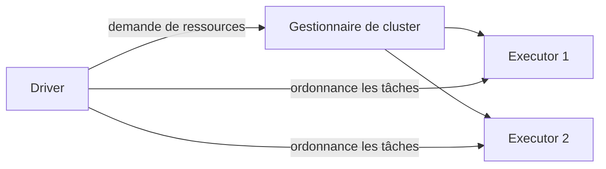
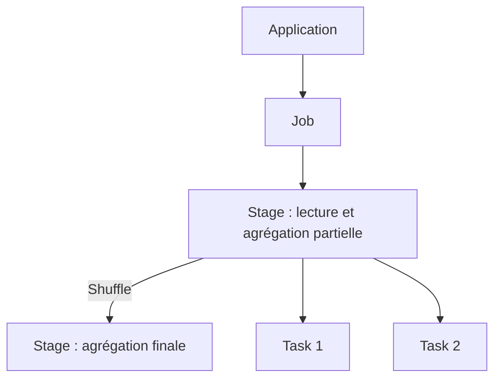
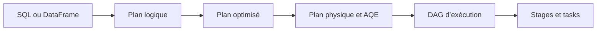

# Comprendre Spark : de Hadoop à l’exécution distribuée

## 1. Le rôle de Spark
HDFS stocke les données, YARN gère les ressources, et MapReduce et Spark assurent le calcul. Spark peut utiliser HDFS et YARN ; il faut comparer Spark au moteur MapReduce plutôt qu’à tout l’écosystème Hadoop. Spark Core fournit les fonctions d’exécution, Spark SQL traite les données structurées, Structured Streaming les flux, MLlib l’apprentissage automatique et GraphX les graphes.

## 2. Architecture et ordonnancement
Le Driver exécute la logique et planifie les tâches ; le gestionnaire de cluster attribue les ressources ; les Executors exécutent les tâches, mettent des données en cache et transmettent leur état. Une partition est une unité de parallélisme.

Une application peut contenir plusieurs jobs. Un job est découpé en stages selon les dépendances ; chaque stage comprend des tasks, généralement une par partition. Une tâche échouée peut être relancée. Les transformations telles que `filter` construisent généralement un plan paresseux ; les actions comme `show`, `count` ou l’écriture déclenchent le calcul, sans garantir exactement un job par action. Les dépendances de shuffle délimitent souvent les stages ; leur nombre dépend du plan.


## 3. Comprendre le shuffle avec AVG
```sql
SELECT branch_id, AVG(amount)
FROM orders WHERE status = 'PAID'
GROUP BY branch_id;
```
Chaque partition filtre ses lignes et calcule une somme et un nombre partiels par établissement. Spark redistribue ces états par clé, les fusionne puis divise. Un résultat local n’est pas le résultat global.

| Partition | Montants | Somme | Nombre | Moyenne locale |
|---|---|---:|---:|---:|
| P1 | 10, 20, 30 | 60 | 3 | 20 |
| P2 | 100 | 100 | 1 | 100 |

La moyenne des moyennes locales donne 60, ce qui est faux. La bonne réponse est (60+100)/(3+1)=40. AVG ignore les valeurs NULL et renvoie NULL si toutes les valeurs du groupe sont NULL. Les flottants peuvent présenter des écarts d’arrondi ; pour les montants, envisager un type décimal.

## 4. Spark et MapReduce
Des jobs MapReduce enchaînés écrivent souvent leur sortie sur HDFS avant la lecture par le job suivant. Spark peut enchaîner les opérations à dépendance étroite sans écrire chaque étape sur HDFS ; les regroupements entre partitions nécessitent toujours un shuffle, qui écrit souvent des fichiers locaux et peut déborder sur disque. Un combiner MapReduce peut aussi agréger localement quand c’est applicable et son exécution n’est pas garantie. Le cache doit être demandé explicitement ; les données non mises en cache peuvent être recalculées. Les performances dépendent des données, des ressources et du plan.

## 5. Catalyst et DAG
Catalyst analyse les plans logiques SQL/DataFrame, applique des règles d’optimisation et peut utiliser des statistiques pour choisir un plan physique. AQE peut modifier une partie du plan à partir des statistiques d’exécution. Les dépendances forment un DAG ; l’ordonnanceur découpe les stages selon ces dépendances et les shuffles. Ce processus utilise des règles et des algorithmes, sans nécessiter d’IA. Les RDD ne suivent pas le même chemin d’optimisation SQL Catalyst.


## 6. Modes de déploiement
Local utilise des threads locaux ; Standalone utilise le gestionnaire de Spark ; YARN et Kubernetes gèrent leurs propres ressources. Client et cluster décrivent l’emplacement du Driver : sur la machine de soumission en mode client, dans le cluster en mode cluster. Avec YARN en mode cluster, le Driver s’exécute dans le processus ApplicationMaster ; en mode client il reste sur la machine de soumission.
```bash
spark-submit --master yarn --deploy-mode cluster app.py
```

## 7. Petits fichiers et déséquilibre
De nombreux petits fichiers augmentent les coûts de métadonnées, de listage et d’ouverture, et peuvent créer trop de petites tâches ; Spark peut regrouper des fichiers dans une partition de lecture. Le déséquilibre apparaît lorsque certaines clés ou partitions sont très volumineuses et ralentissent quelques tâches ; les petits fichiers ne provoquent pas nécessairement un déséquilibre des clés. Comparer durées, entrées, shuffle et débordements dans Spark UI. Compacter les fichiers ou ajuster les partitions : `coalesce` réduit généralement les partitions sans shuffle complet, tandis que `repartition` effectue un shuffle. Pour le déséquilibre, envisager une préagrégation, une jointure par diffusion appropriée ou un salage des clés chaudes suivi d’une seconde agrégation ; AQE ne résout que certains cas.

## 8. Travaux pratiques
Exécuter dans un environnement PySpark configuré :
```python
from pyspark.sql import SparkSession, functions as F
spark = SparkSession.builder.master('local[2]').appName('SparkLesson').getOrCreate()
spark.conf.set('spark.sql.shuffle.partitions', '2')
rows = [('A', 10.0, 'PAID'), ('A', 20.0, 'PAID'), ('A', 30.0, 'PAID'), ('A', 100.0, 'PAID'), ('B', 50.0, 'PAID'), ('B', None, 'PAID'), ('B', 999.0, 'CANCELLED')]
df = spark.createDataFrame(rows, ['branch_id', 'amount', 'status']).repartition(2)
result = df.filter(F.col('status') == 'PAID').groupBy('branch_id').agg(F.avg('amount').alias('avg_amount'))
result.explain('formatted')
result.orderBy('branch_id').show()  # A = 40, B = 50
input('Consultez Spark UI (souvent http://localhost:4040), puis Entrée : ')
spark.stop()
```
Repérer le filtre, l’agrégation partielle, Exchange et l’agrégation finale dans le plan ; examiner les jobs, stages et shuffles dans l’interface. `repartition` entraîne lui-même un shuffle. Un petit jeu de données ne permet pas de conclure sur les performances en production.

## 9. Questions et réponses
- **Comment traiter des données distribuées à l’avance ?** Chaque partition calcule un état fusionnable, puis les états sont réunis.
- **Tout reste-t-il en mémoire ?** Non ; le shuffle et les débordements peuvent utiliser le disque.
- **Plus de partitions corrigent-elles toujours le déséquilibre ?** Non ; une clé très fréquente peut rester concentrée.
- **Un DAG nécessite-t-il de l’IA ?** Non ; Spark utilise les dépendances et des règles de planification.

## Références officielles
- [Architecture de cluster](https://spark.apache.org/docs/latest/cluster-overview.html)
- [RDD et shuffle](https://spark.apache.org/docs/latest/rdd-programming-guide.html)
- [Optimisation SQL et AQE](https://spark.apache.org/docs/latest/sql-performance-tuning.html)
- [Exécution sur YARN](https://spark.apache.org/docs/latest/running-on-yarn.html)
- [Interface Spark](https://spark.apache.org/docs/latest/web-ui.html)
- [Sémantique NULL](https://spark.apache.org/docs/latest/sql-ref-null-semantics.html)
