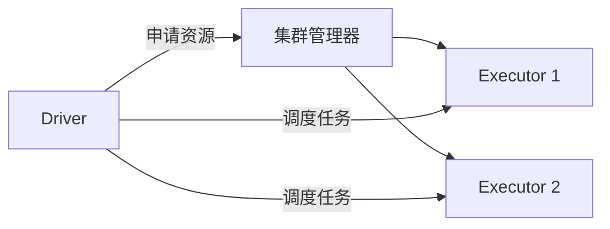
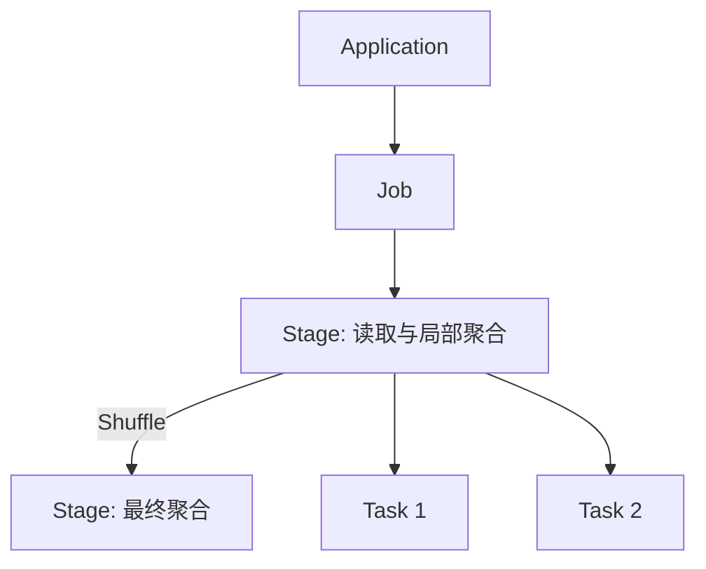
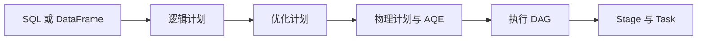
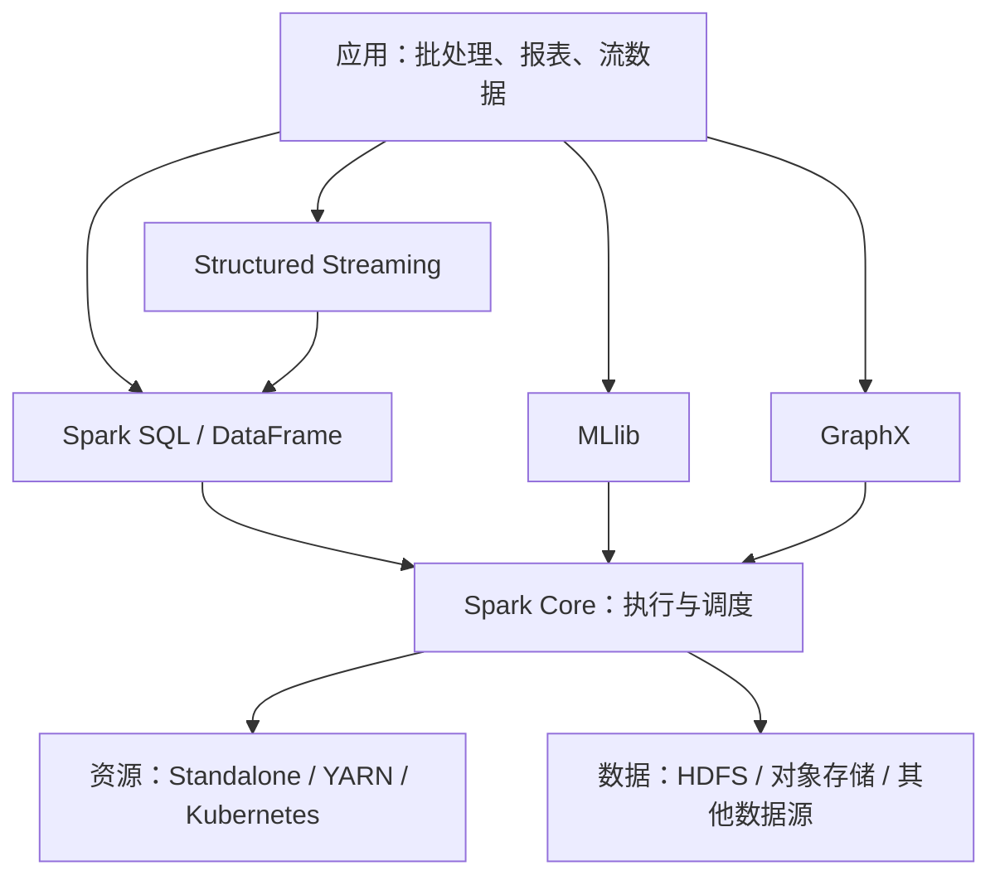
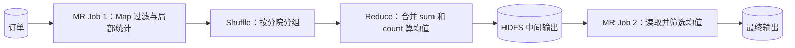
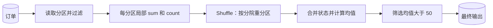
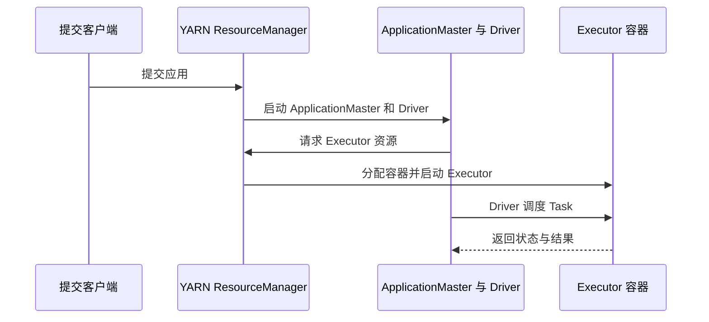

# Spark 第一课：从 Hadoop 到分布式执行

## 1. Spark 的位置
HDFS 负责存储，YARN 负责资源管理，MapReduce 与 Spark 负责计算。Spark 可以使用 HDFS 和 YARN；比较性能时，应将 Spark 与 MapReduce 计算引擎比较，而不是与整个 Hadoop 生态比较。Spark Core 负责基础执行，Spark SQL 处理结构化数据，Structured Streaming 处理流数据，MLlib 提供机器学习工具，GraphX 支持图计算。

## 2. 架构与任务调度
Driver 运行应用逻辑并规划、调度任务；集群管理器分配资源；Executor 在分配到的资源上执行任务、缓存数据并报告状态。分区是并行处理的数据单位。



一个 Application 可以包含多个 Job；Job 根据依赖划分为 Stage；每个 Stage 包含多个 Task，通常一个 Task 处理一个分区。失败 Task 可以重试。`filter` 等转换通常惰性构建计划，`show`、`count` 和写入等操作触发计算，但一次 action 不保证恰好对应一个 Job。Shuffle 通常形成 Stage 边界，实际数量由执行计划决定。



## 3. 用订单均值理解 Shuffle
```sql
SELECT branch_id, AVG(amount)
FROM orders WHERE status = 'PAID'
GROUP BY branch_id;
```
各分区先过滤并计算各分院的局部 sum 和 count，再按分院 Shuffle，合并后相除。局部结果并非全局结果。

| 分区 | 金额 | sum | count | 局部均值 |
|---|---|---:|---:|---:|
| P1 | 10, 20, 30 | 60 | 3 | 20 |
| P2 | 100 | 100 | 1 | 100 |

直接平均局部均值得到 60，是错误的；正确答案为 (60+100)/(3+1)=40。SQL AVG 忽略 NULL，全为 NULL 时结果为 NULL。浮点数存在舍入差异，金额可考虑 decimal。

## 4. Spark 与 MapReduce
多个 MapReduce Job 串联时，Job 间常需将结果写入 HDFS 后再读取。Spark 可以流水线执行窄依赖操作，避免每一步都写 HDFS；但跨分区分组仍需 Shuffle，Shuffle 通常写本地磁盘，内存不足也可能 spill。MapReduce 的 Combiner 在适用时也可局部聚合，且不保证执行。缓存需要显式指定，未缓存的数据可能重新计算。速度取决于数据、资源和执行计划。

## 5. Catalyst 与 DAG
Catalyst 分析 SQL/DataFrame 的逻辑计划，按规则优化，并结合可用统计信息选择物理方案。AQE 可根据运行时统计调整部分计划。执行依赖形成 DAG，调度器按依赖和 Shuffle 划分 Stage；这使用算法与规则，不需要 AI。RDD 不经过同一套 SQL Catalyst 优化。



## 6. 运行模式
Local 用本机线程；Standalone 使用 Spark 自带集群管理器；YARN 和 Kubernetes 使用各自的资源管理系统。Client 与 cluster 描述 Driver 位置：client 在提交端，cluster 在集群内。YARN cluster 模式中 Driver 运行在 ApplicationMaster 进程中；client 模式 Driver 留在提交端。

```bash
spark-submit --master yarn --deploy-mode cluster app.py
```

## 7. 小文件与数据倾斜
大量小文件增加元数据、列举与打开开销，并可能产生过多小任务；Spark 可把多个文件合并为扫描分区。倾斜指部分 key 或分区数据量异常大，造成任务拖尾；小文件不必然造成 key 倾斜。通过 Spark UI 比较任务时长、输入、Shuffle 和 spill；小文件可考虑合并写出，`coalesce` 通常减少分区且避免完整 Shuffle，`repartition` 会 Shuffle。倾斜可考虑预聚合、合适的广播 join 或热点 key 加盐并二次聚合；AQE 只能处理部分倾斜场景。

## 8. 实验
在配置好的 PySpark 环境中运行：
```python
from pyspark.sql import SparkSession, functions as F
spark = SparkSession.builder.master('local[2]').appName('SparkLesson').getOrCreate()
spark.conf.set('spark.sql.shuffle.partitions', '2')
rows = [('A', 10.0, 'PAID'), ('A', 20.0, 'PAID'), ('A', 30.0, 'PAID'), ('A', 100.0, 'PAID'), ('B', 50.0, 'PAID'), ('B', None, 'PAID'), ('B', 999.0, 'CANCELLED')]
df = spark.createDataFrame(rows, ['branch_id', 'amount', 'status']).repartition(2)
result = df.filter(F.col('status') == 'PAID').groupBy('branch_id').agg(F.avg('amount').alias('avg_amount'))
result.explain('formatted')
result.orderBy('branch_id').show()  # A = 40, B = 50
input('查看 Spark UI（通常为 http://localhost:4040），按 Enter 退出：')
spark.stop()
```
在计划中寻找过滤、局部聚合、Exchange 和最终聚合；在 UI 查看 Job、Stage 和 Shuffle。`repartition` 本身也会 Shuffle。小数据不适合用于判断生产性能。

## 9. 常见问题
- **数据分散为何能提前计算？** 每个分区先计算可合并的状态，随后跨分区汇总。
- **Spark 全在内存中吗？** 不是；Shuffle 和 spill 可写磁盘。
- **增加分区一定解决倾斜吗？** 不一定，同一个热点 key 仍可能集中。
- **DAG 需要 AI 吗？** 不需要，Spark 根据依赖和规划规则执行。


## 第一课补充 A：组件全景与分层

先区分两个含义：Spark 的**功能组件**回答“能处理什么问题”，运行架构中的 Driver、Executor 与 Cluster Manager 回答“谁来完成计算”。

| 层次 | 组件 | 职责与例子 |
|---|---|---|
| 基础执行 | Spark Core | 分布式任务调度、内存管理、失败恢复；RDD 是其基础抽象之一 |
| 结构化计算 | Spark SQL | SQL、DataFrame、优化器与结构化数据源，例如订单报表 |
| 流处理 | Structured Streaming | 基于结构化 API 的持续数据处理；具体语义由输出模式、数据源与配置决定 |
| 机器学习 | MLlib | 特征处理、机器学习算法和流水线 |
| 图计算 | GraphX | 图和图并行计算，主要面向 Scala API |
| 资源管理 | Standalone / YARN / Kubernetes | 为应用分配资源；并不执行用户业务逻辑 |



图是概念示意，不表示每个 API 的所有内部依赖。一个应用可以组合多种组件；Spark 不是存储系统，数据源的能力和配置也会影响实际执行。

## 第一课补充 B：MapReduce 对比的完整路线

以“统计已支付订单的分院平均金额，再筛出平均金额超过 50 的分院”为例。下面比较的是一种常见的**多 Job MapReduce 实现**和一种 Spark 实现，并非唯一写法，也不是性能基准。





| 比较点 | 多 Job MapReduce 示例 | Spark 示例 |
|---|---|---|
| 读取 | 每个 Job 读取输入；后续 Job 可读取前一输出 | 上游数据分区由任务读取 |
| 分组 | Map 输出经 Shuffle 到 Reduce；可使用 Combiner | 局部聚合后经 Shuffle 到最终聚合 |
| Job 之间 | 示例中 Job 1 输出写 HDFS，Job 2 再读 | 后续窄依赖操作可接在执行流水线中，通常无需为每个算子写 HDFS |
| 磁盘 | Map 输出和 Shuffle 会用磁盘，Job 输出可写 HDFS | Shuffle 通常使用本地磁盘；可能 spill；最终输出仍写入目标存储 |
| 重复使用 | 可复用已物化输出 | 可显式 `cache` / `persist`；未缓存可能重算，缓存也可能被驱逐 |
| 恢复 | 依赖持久化输出、任务重试 | 任务重试及数据血缘等机制可用于恢复；具体由数据和运行环境决定 |

**关键边界：** Spark 并不是在不同机器交换数据之前就得到全局均值，也不是永远不写磁盘。单个 MapReduce Job 也能同时做过滤、局部处理和分组；例如在最终 Reduce 阶段还可筛选均值。图中的第二个 Job 只是为了清楚展示多 Job 物化成本，不是该 SQL 的必需条件。

### 手算：局部聚合究竟传了什么？

假设 P1 的 A 分院数据为 10、20、30，P2 的 A 分院为 100；P1 同时有 B=50。过滤后，P1 为 A 输出 `(sum=60,count=3)`、B 输出 `(50,1)`；P2 为 A 输出 `(100,1)`。按 key Shuffle 后，处理 A 的任务收到 `(60,3)` 和 `(100,1)`，合并为 `(160,4)`，得到 40。网络发送的是可合并状态，**不是各分区的最终全局答案**。若每条记录的 key 都不同，局部聚合未必显著减少数据量。

对一般聚合，必须确认状态可正确合并。平均值不能简单平均局部均值；SQL 中 `COUNT(amount)` 忽略 NULL，而 `COUNT(*)` 计算行数。对于不同数据类型、溢出和浮点舍入，结果细节应以实际 Spark SQL 语义为准。

## 第一课补充 C：运行模式、部署位置与调度策略

这三组概念经常被混为一谈：

1. **运行环境 / 集群管理器**：Local、Standalone、YARN、Kubernetes，决定资源在哪里以及由谁分配。
2. **部署模式**：client 或 cluster，决定 Driver 在提交端还是集群内。支持情况依集群管理器和语言而异。
3. **应用内部 Job 调度**：FIFO 或 FAIR，决定同一 SparkContext 内多个并发 Job 如何竞争可用资源。这与选择 YARN 或 Kubernetes 不是同一个维度。

| 方式 | 适用场景与要点 |
|---|---|
| Local | 单机学习与调试；`local[2]` 表示本地使用两个工作线程 |
| Standalone | Spark 自带集群管理器，适合独立搭建 Spark 集群 |
| YARN | 复用 Hadoop 的资源管理；ApplicationMaster 参与应用资源协调 |
| Kubernetes | 在 Kubernetes 上运行 Driver 与 Executor，依赖相应集群配置 |
| FIFO | Spark 应用内默认策略：先提交的 Job 优先；不等于整个集群的 YARN 队列策略 |
| FAIR | 在并发 Job 或调度池之间较公平地共享资源；具体份额取决于配置与可用资源 |

YARN cluster 模式示意：



图中角色是逻辑示意，容器启动涉及相应 NodeManager。Client 模式下 Driver 留在提交端，ApplicationMaster 仍负责协调 YARN 资源；客户端终止可能影响应用。

```python
# 必须在创建 SparkContext 前设置；FAIR 是应用内 Job 策略
from pyspark.sql import SparkSession
spark = (SparkSession.builder
         .appName('FairSchedulingExample')
         .config('spark.scheduler.mode', 'FAIR')
         .getOrCreate())
```

FAIR 并不会自动改变单个 Job 的 Task 数，也不会替代 YARN 的队列调度；多 Job 并发与池配置需要应用实际提交并行工作。生产配置应结合 Spark 和 YARN 版本核对。

## 第一课补充 D：动手思考与答案

**练习 1：** P1 为 A 的 2、4，P2 为 A 的 9。计算各分区 `(sum,count)` 和全局 AVG。  
**答案：** `(6,2)`、`(9,1)`；合并 `(15,3)`，结果 5。局部均值 3 与 9 的简单平均为 6，错误。

**练习 2：** 一次计算出现两个 Stage，就能断言只产生一个 Job 吗？  
**答案：** 不能。Stage 属于 Job，但一次 action 可能触发多个 Job；以 Spark UI 实际记录为准。

**练习 3：** 如果文件很多但单个热点 key 占了大多数数据，先解决哪个？  
**答案：** 两者分别测量。扫描阶段关注文件数与任务开销；Shuffle 后查看各任务的数据量和时长，热点 key 需要对应的倾斜治理。

**探索：** 执行实验后打开 SQL 与 Stages 页面，对照 Exchange、Shuffle read/write、Task 时长；再改变输入规模或分区数量并记录差异。不要用极小样本判断生产速度。

> 后续课程可以继续深入 RDD 与 DataFrame、Shuffle 内部机制、内存与缓存、Spark SQL 调优，以及流处理。本课是后续内容的基础。


## 官方参考
- [集群模式](https://spark.apache.org/docs/latest/cluster-overview.html)
- [RDD 与 Shuffle](https://spark.apache.org/docs/latest/rdd-programming-guide.html)
- [SQL 调优与 AQE](https://spark.apache.org/docs/latest/sql-performance-tuning.html)
- [YARN 部署](https://spark.apache.org/docs/latest/running-on-yarn.html)
- [Spark UI](https://spark.apache.org/docs/latest/web-ui.html)
- [NULL 语义](https://spark.apache.org/docs/latest/sql-ref-null-semantics.html)

- [Job 调度与 FAIR](https://spark.apache.org/docs/latest/job-scheduling.html)
- [Spark 文档总览](https://spark.apache.org/docs/latest/)

