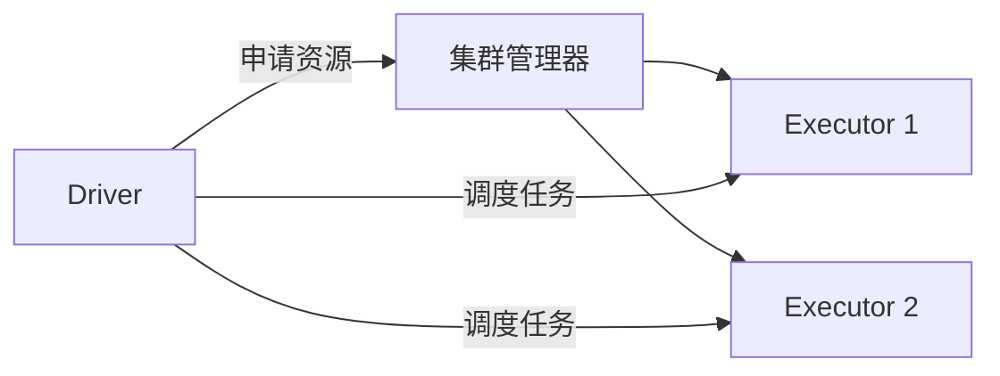
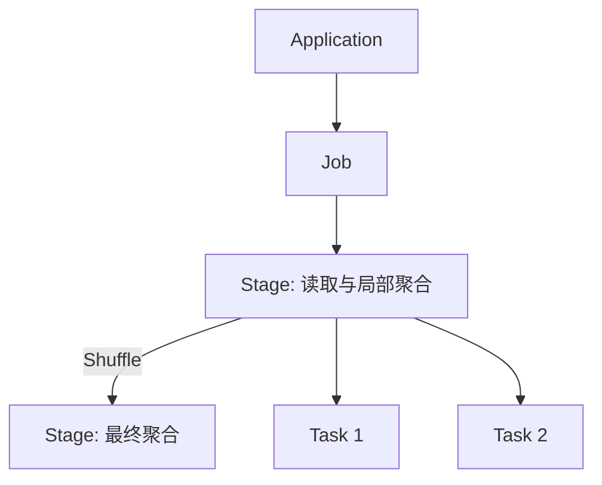
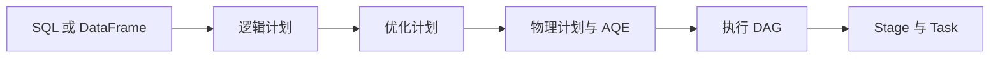

# Spark 入门：从 Hadoop 到分布式执行

## 1. Spark 的位置
HDFS 负责存储，YARN 负责资源管理，MapReduce 与 Spark 负责计算。Spark 可以使用 HDFS 和 YARN；比较性能时，应将 Spark 与 MapReduce 计算引擎比较，而不是与整个 Hadoop 生态比较。Spark Core 负责基础执行，Spark SQL 处理结构化数据，Structured Streaming 处理流数据，MLlib 提供机器学习工具，GraphX 支持图计算。

## 2. 架构与任务调度
Driver 运行应用逻辑并规划、调度任务；集群管理器分配资源；Executor 在分配到的资源上执行任务、缓存数据并报告状态。分区是并行处理的数据单位。



一个 Application 可以包含多个 Job；Job 根据依赖划分为 Stage；每个 Stage 包含多个 Task，通常一个 Task 处理一个分区。失败 Task 可以重试。`filter` 等转换通常惰性构建计划，`show`、`count` 和写入等操作触发计算，但一次 action 不保证恰好对应一个 Job。Shuffle 通常形成 Stage 边界，实际数量由执行计划决定。



## 3. 用订单均值理解 Shuffle
```sql
SELECT branch_id, AVG(amount)
FROM orders WHERE status = 'PAID'
GROUP BY branch_id;
```
各分区先过滤并计算各分院的局部 sum 和 count，再按分院 Shuffle，合并后相除。局部结果并非全局结果。

| 分区 | 金额 | sum | count | 局部均值 |
|---|---|---:|---:|---:|
| P1 | 10, 20, 30 | 60 | 3 | 20 |
| P2 | 100 | 100 | 1 | 100 |

直接平均局部均值得到 60，是错误的；正确答案为 (60+100)/(3+1)=40。SQL AVG 忽略 NULL，全为 NULL 时结果为 NULL。浮点数存在舍入差异，金额可考虑 decimal。

## 4. Spark 与 MapReduce
多个 MapReduce Job 串联时，Job 间常需将结果写入 HDFS 后再读取。Spark 可以流水线执行窄依赖操作，避免每一步都写 HDFS；但跨分区分组仍需 Shuffle，Shuffle 通常写本地磁盘，内存不足也可能 spill。MapReduce 的 Combiner 在适用时也可局部聚合，且不保证执行。缓存需要显式指定，未缓存的数据可能重新计算。速度取决于数据、资源和执行计划。

## 5. Catalyst 与 DAG
Catalyst 分析 SQL/DataFrame 的逻辑计划，按规则优化，并结合可用统计信息选择物理方案。AQE 可根据运行时统计调整部分计划。执行依赖形成 DAG，调度器按依赖和 Shuffle 划分 Stage；这使用算法与规则，不需要 AI。RDD 不经过同一套 SQL Catalyst 优化。



## 6. 运行模式
Local 用本机线程；Standalone 使用 Spark 自带集群管理器；YARN 和 Kubernetes 使用各自的资源管理系统。Client 与 cluster 描述 Driver 位置：client 在提交端，cluster 在集群内。YARN cluster 模式中 Driver 运行在 ApplicationMaster 进程中；client 模式 Driver 留在提交端。

```bash
spark-submit --master yarn --deploy-mode cluster app.py
```

## 7. 小文件与数据倾斜
大量小文件增加元数据、列举与打开开销，并可能产生过多小任务；Spark 可把多个文件合并为扫描分区。倾斜指部分 key 或分区数据量异常大，造成任务拖尾；小文件不必然造成 key 倾斜。通过 Spark UI 比较任务时长、输入、Shuffle 和 spill；小文件可考虑合并写出，`coalesce` 通常减少分区且避免完整 Shuffle，`repartition` 会 Shuffle。倾斜可考虑预聚合、合适的广播 join 或热点 key 加盐并二次聚合；AQE 只能处理部分倾斜场景。

## 8. 实验
在配置好的 PySpark 环境中运行：
```python
from pyspark.sql import SparkSession, functions as F
spark = SparkSession.builder.master('local[2]').appName('SparkLesson').getOrCreate()
spark.conf.set('spark.sql.shuffle.partitions', '2')
rows = [('A', 10.0, 'PAID'), ('A', 20.0, 'PAID'), ('A', 30.0, 'PAID'), ('A', 100.0, 'PAID'), ('B', 50.0, 'PAID'), ('B', None, 'PAID'), ('B', 999.0, 'CANCELLED')]
df = spark.createDataFrame(rows, ['branch_id', 'amount', 'status']).repartition(2)
result = df.filter(F.col('status') == 'PAID').groupBy('branch_id').agg(F.avg('amount').alias('avg_amount'))
result.explain('formatted')
result.orderBy('branch_id').show()  # A = 40, B = 50
input('查看 Spark UI（通常为 http://localhost:4040），按 Enter 退出：')
spark.stop()
```
在计划中寻找过滤、局部聚合、Exchange 和最终聚合；在 UI 查看 Job、Stage 和 Shuffle。`repartition` 本身也会 Shuffle。小数据不适合用于判断生产性能。

## 9. 常见问题
- **数据分散为何能提前计算？** 每个分区先计算可合并的状态，随后跨分区汇总。
- **Spark 全在内存中吗？** 不是；Shuffle 和 spill 可写磁盘。
- **增加分区一定解决倾斜吗？** 不一定，同一个热点 key 仍可能集中。
- **DAG 需要 AI 吗？** 不需要，Spark 根据依赖和规划规则执行。

## 官方参考
- [集群模式](https://spark.apache.org/docs/latest/cluster-overview.html)
- [RDD 与 Shuffle](https://spark.apache.org/docs/latest/rdd-programming-guide.html)
- [SQL 调优与 AQE](https://spark.apache.org/docs/latest/sql-performance-tuning.html)
- [YARN 部署](https://spark.apache.org/docs/latest/running-on-yarn.html)
- [Spark UI](https://spark.apache.org/docs/latest/web-ui.html)
- [NULL 语义](https://spark.apache.org/docs/latest/sql-ref-null-semantics.html)
